<!--
KHUNG BÁO CÁO. Các dòng trong <!-- --> là ghi chú cho bạn, không hiện trong PDF.
- Hình và bảng đọc từ figures/ và report/*.csv do notebook 05–10 xuất ra. Chạy lại notebook thì báo cáo tự cập nhật.
- Chỗ "[VIẾT: ...]" là phần bạn phải tự viết.
- Render: quarto render report/bao_cao.qmd --to pdf
  (cần TinyTeX: quarto install tinytex; nếu Quarto không thấy Python: đặt QUARTO_PYTHON = đường dẫn .venv\Scripts\python.exe)
- Giới hạn 45 trang không tính code.
-->

```{python}
import pandas as pd
from IPython.display import Markdown

REP, FIG = ".", "../figures"

def tbl(path, index=False, floatfmt=".3f", **kw):
    df = pd.read_csv(f"{REP}/{path}", **kw)
    return Markdown(df.to_markdown(index=index, floatfmt=floatfmt))
```

# Thông tin chung {.unnumbered}

## Bảng phân công nhiệm vụ {.unnumbered}

| Thành viên | MSSV | Phụ trách | Tỉ lệ hoàn thành |
|---|---|---|---|
| [Họ tên] | [MSSV] | [VIẾT] | 100% |

## Danh mục từ viết tắt {.unnumbered}

| Viết tắt | Nghĩa |
|---|---|
| ABSA | Aspect-Based Sentiment Analysis – phân tích cảm xúc theo khía cạnh |
| CRISP-DM | Cross-Industry Standard Process for Data Mining |
| CV | Cross-Validation – kiểm định chéo |
| CSKH | Chăm sóc khách hàng |
| F1-macro | Trung bình F1 của các lớp, không trọng số |
| HITL | Human-in-the-loop – có con người trong vòng ra quyết định |
| LR | Logistic Regression |
| NB | Naive Bayes |
| PR-AUC | Diện tích dưới đường Precision–Recall |
| ROC-AUC | Diện tích dưới đường ROC |
| SHAP | SHapley Additive exPlanations |
| TF-IDF | Term Frequency – Inverse Document Frequency |
| XAI | Explainable AI – AI có thể giải thích |

## Lời cảm ơn và tuyên bố sử dụng AI {.unnumbered}

[VIẾT: lời cảm ơn.]

**Tuyên bố sử dụng công cụ AI.** Trong quá trình thực hiện, nhóm sử dụng Claude (Anthropic) để: [VIẾT, ví dụ: gợi ý cấu trúc mã nguồn và cú pháp thư viện, kiểm tra số liệu dữ liệu, góp ý dàn ý báo cáo, gán ngành hàng sơ bộ cho 32 sản phẩm]. Nhóm đã tự chạy lại, kiểm tra và chịu trách nhiệm về toàn bộ mã nguồn, số liệu và nhận định. Nhãn của tập vàng do nhóm tự gán thủ công. Nội dung phân tích và kết luận do nhóm tự viết.

# Giới thiệu và xác định bài toán kinh doanh

## Bối cảnh thực tiễn và nỗi đau kinh doanh

<!-- Empathize. 1/2 trang. Số review mỗi ngày trên Shopee; shop nhỏ không đủ người đọc; review chê không được xử lý thì mất khách và bị đánh giá xấu lan truyền; số sao không phản ánh nội dung (dẫn bảng chéo nhãn tay × sao ở mục 3). -->

[VIẾT]

## Chân dung người dùng và bản đồ thấu cảm

<!-- 1–2 persona. Empathy Map 4 ô + Pain/Gain. -->

**Persona 1 – [Tên], chủ shop mỹ phẩm nhỏ trên Shopee.** [VIẾT: tuổi, công việc, mục tiêu, khó khăn]

| Nghĩ & cảm thấy | Nhìn thấy |
|---|---|
| [VIẾT] | [VIẾT] |
| **Nói & làm** | **Nghe thấy** |
| [VIẾT] | [VIẾT] |

: Bản đồ thấu cảm của persona chủ shop {#tbl-empathy}

**Nỗi đau (Pain):** [VIẾT]. **Mong muốn (Gain):** [VIẾT].

## Phân loại bài toán AI và mục tiêu SMART

Bài toán thuộc nhóm **Insight** (khai phá lý do khách hài lòng hoặc không hài lòng từ văn bản) kết hợp **Solution** (tự động gắn nhãn và cảnh báo review tiêu cực).

| Tiêu chí | Mục tiêu |
|---|---|
| Specific | [VIẾT] |
| Measurable | F1-macro ≥ [..] trên tập vàng; Recall lớp tiêu cực ≥ [..] |
| Achievable | [VIẾT] |
| Relevant | [VIẾT] |
| Time-bound | [VIẾT] |

: Mục tiêu SMART {#tbl-smart}

## Ước tính hiệu quả kinh tế

<!-- Số liệu từ notebook 09, mục 3. Nói rõ đâu là giả định. -->

```{python}
#| label: tbl-cost
#| tbl-cap: "Chi phí vận hành mỗi tháng của các chiến lược đọc review (giả định trong notebook 09)"
df = pd.read_csv("cost_strategies.csv", index_col=0)
df = df[["Số review phải đọc/tháng", "Bỏ sót review chê/tháng", "Recall neg", "Tổng chi phí/tháng"]]
Markdown(df.to_markdown(floatfmt=(",.0f", ",.0f", ",.0f", ".2f", ",.0f")))
```

```{python}
#| label: tbl-roi
#| tbl-cap: "Phân tích độ nhạy ROI 12 tháng so với cách lọc theo sao"
df = pd.read_csv("roi_sensitivity.csv", index_col=0)
Markdown((df * 100).round(0).astype(int).astype(str).add("%").to_markdown())
```

[VIẾT: nhận xét ROI.]

# Cơ sở lý thuyết và quy trình nghiên cứu

## Quy trình CRISP-DM

<!-- Vẽ sơ đồ 6 bước (draw.io, lưu figures/crispdm.png) rồi bỏ comment dòng hình dưới. -->
<!-- 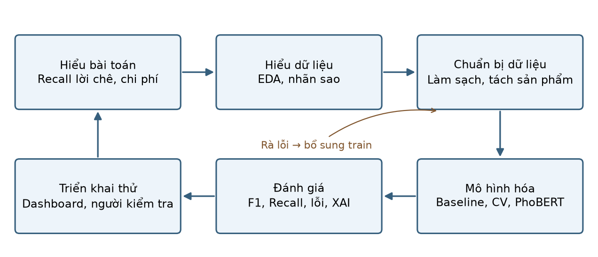{#fig-crispdm width=85%} -->

| Giai đoạn | Việc trong đồ án | Notebook |
|---|---|---|
| Business Understanding | Persona, SMART, ROI | 09 |
| Data Understanding | EDA 3 nguồn dữ liệu | 01, 05 |
| Data Preparation | Làm sạch, chia theo sản phẩm, tiền xử lý, đặc trưng mới, tập vàng | 02, 03, 05 |
| Modeling | Baseline, TF-IDF + LR/SVC, Word2Vec, PhoBERT, tinh chỉnh | 04, 06, 07, 08 |
| Evaluation | F1, ROC/PR-AUC, chi phí, SHAP, fairness | 09 |
| Deployment | ABSA, dashboard Streamlit | 10, app |

: Ánh xạ CRISP-DM vào đồ án [@wirth2000crispdm] {#tbl-crispdm}

## Các thuật toán sử dụng

<!-- Mỗi thuật toán 1 đoạn: nguyên lý + vì sao chọn. -->

- **Naive Bayes trên Bag-of-Words** (baseline): [VIẾT]
- **TF-IDF + Logistic Regression / LinearSVC** [@pedregosa2011sklearn]: [VIẾT]
- **Word2Vec** [@mikolov2013word2vec]: [VIẾT]
- **PhoBERT** [@nguyen2020phobert; @devlin2019bert]: [VIẾT]
- **ABSA bằng từ điển** [@pontiki2014semeval]: [VIẾT]
- **SHAP** [@lundberg2017shap]: [VIẾT]

# Khám phá và tiền xử lý dữ liệu

## Nguồn dữ liệu và từ điển dữ liệu

```{python}
#| label: tbl-sources
#| tbl-cap: "Ba nguồn dữ liệu và vai trò"
tbl("data_sources.csv")
```

ViSD4SA [@phan2021visd4sa] ... [VIẾT]

```{python}
#| label: tbl-dict
#| tbl-cap: "Từ điển dữ liệu"
tbl("data_dictionary.csv", encoding="utf-8-sig")
```

## Phân tích khám phá và phát hiện kinh doanh

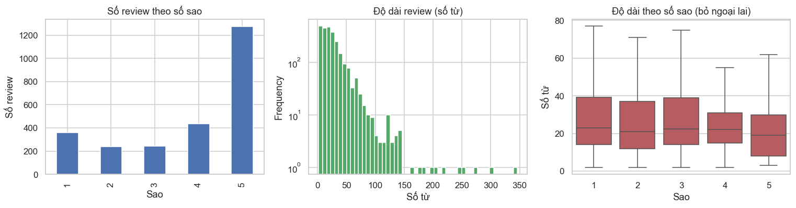{#fig-target width=100%}

[VIẾT: nhận xét, có skewness.]

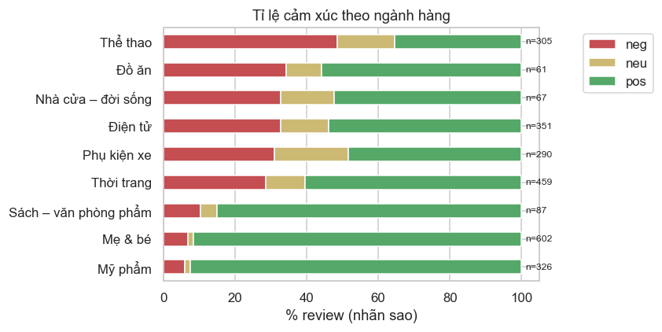{#fig-category width=85%}

[VIẾT]

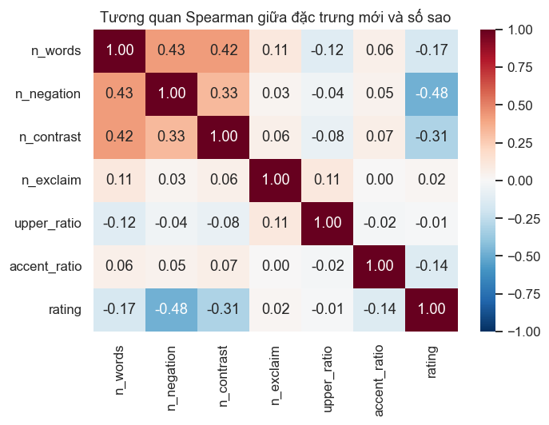{#fig-corr width=65%}

[VIẾT]

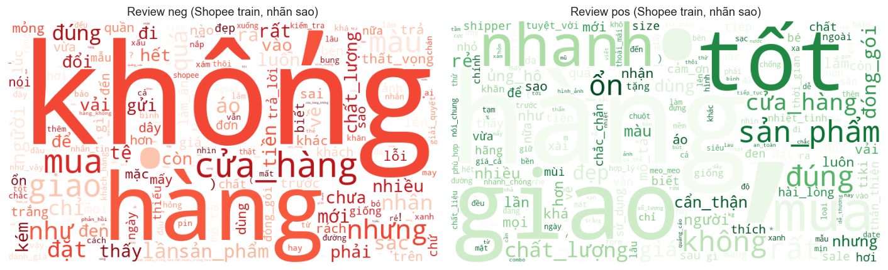{#fig-wc width=100%}

[VIẾT]

<!-- Bảng chéo nhãn tay × số sao (notebook 03) — đưa vào đây sau khi gán xong. -->

## Chuẩn bị dữ liệu

<!-- Bảng các bước làm sạch (data/processed/cleaning_steps.csv), 5 ví dụ trước/sau tiền xử lý,
     lý do chia theo sản phẩm, chống rò rỉ, tập vàng + kappa, đặc trưng mới. -->

```{python}
#| label: tbl-cleaning
#| tbl-cap: "Số dòng sau từng bước làm sạch dữ liệu Shopee"
tbl("../data/processed/cleaning_steps.csv")
```

```{python}
#| label: tbl-preprocess
#| tbl-cap: "Ảnh hưởng của các bước tiền xử lý (TF-IDF + LR, train A+B, F1-macro)"
tbl("preprocess_ablation.csv")
```

[VIẾT]

# Thiết kế, huấn luyện và tối ưu mô hình

## Mô hình cơ sở và kiểm định chéo theo sản phẩm

```{python}
#| label: tbl-cv
#| tbl-cap: "Kết quả GroupKFold 5 fold theo sản phẩm trên Shopee train (F1-macro)"
tbl("cv_results.csv")
```

[VIẾT: vì sao GroupKFold; so với StratifiedKFold (notebook 06 mục 4).]

## Tinh chỉnh siêu tham số và chống quá khớp

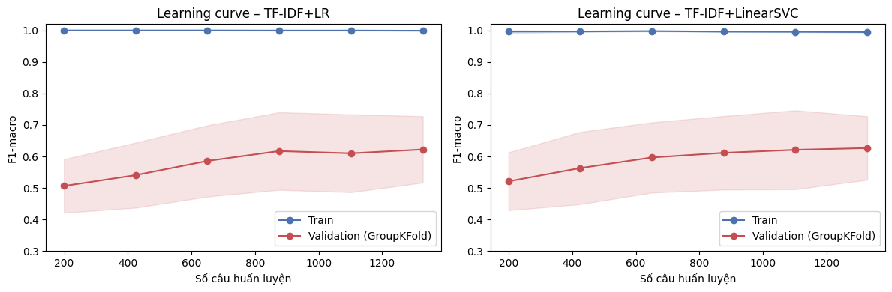{#fig-lc width=100%}

<!-- PhoBERT: chép report/phobert/phobert_loss.png sang figures/ rồi bỏ comment. -->
<!-- 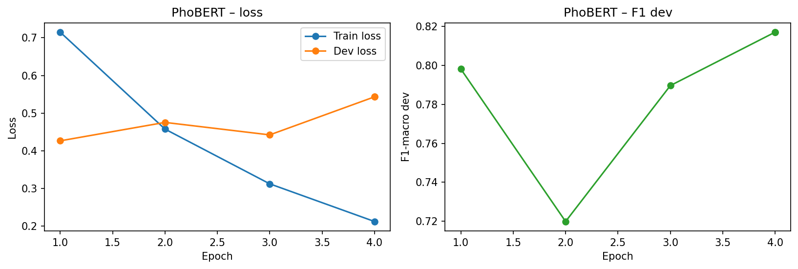{#fig-phobert-loss width=85%} -->

[VIẾT]

## So sánh các mô hình và nguồn huấn luyện

```{python}
#| label: tbl-tuned
#| tbl-cap: "F1-macro trên tập vàng theo mô hình và nguồn huấn luyện"
d = pd.read_csv("tuned_results.csv")
Markdown(d.pivot(index="model", columns="train", values="F1_gold").to_markdown(floatfmt=".3f"))
```

```{python}
#| label: tbl-w2v
#| tbl-cap: "Word2Vec + LR (train A+B)"
tbl("word2vec_results.csv")
```

# Đánh giá chuyên sâu, giải thích mô hình và đạo đức AI

## Chỉ số kỹ thuật

```{python}
#| label: tbl-main
#| tbl-cap: "Kết quả chính trên tập vàng Shopee"
d = pd.read_csv("main_results.csv", index_col=0)
Markdown(d.T.to_markdown(floatfmt=".3f"))
```

```{python}
#| label: tbl-ci
#| tbl-cap: "Khoảng tin cậy bootstrap 95% của F1-macro"
tbl("bootstrap_ci.csv")
```

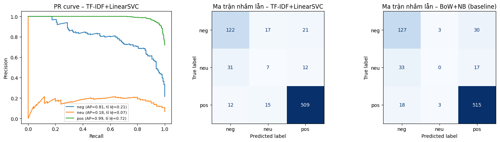{#fig-eval width=100%}

[VIẾT: chọn metric chính; chi phí sai loại 1/loại 2.]

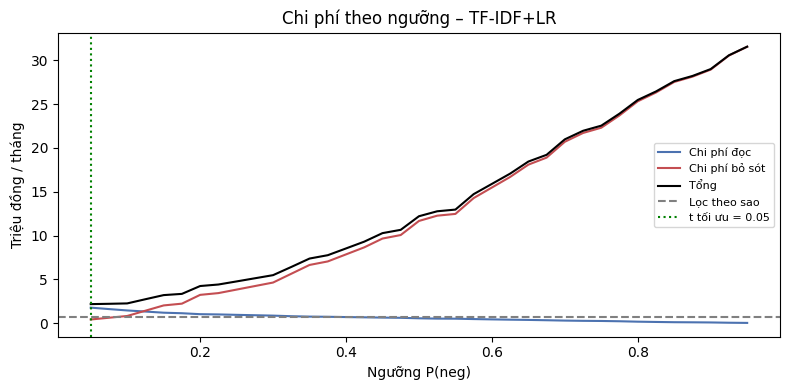{#fig-cost width=75%}

## Giải thích mô hình

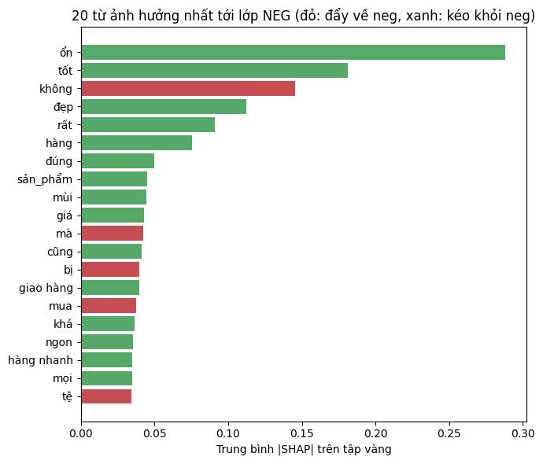{#fig-shap-global width=70%}

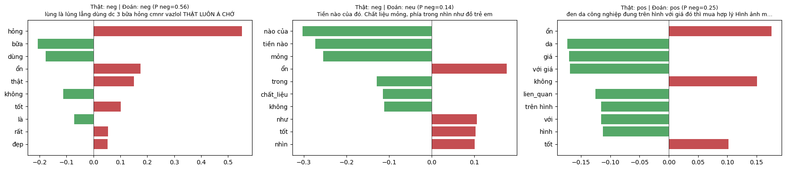{#fig-shap-local width=100%}

[VIẾT]

## Đạo đức AI và rủi ro vận hành

```{python}
#| label: tbl-fair
#| tbl-cap: "Hiệu năng theo ngành hàng"
tbl("fairness_category.csv", encoding="utf-8-sig")
```

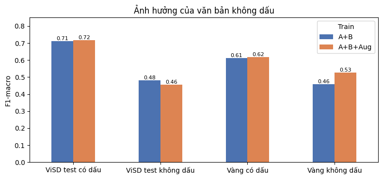{#fig-unaccent width=75%}

```{python}
#| label: tbl-hitl
#| tbl-cap: "Đánh đổi khi chuyển câu không chắc chắn cho nhân viên (Human-in-the-loop)"
tbl("hitl.csv")
```

[VIẾT: thiên lệch, quyền riêng tư, dữ liệu do AI sinh, lối tắt theo tên sản phẩm, HITL.]

## Phân tích lỗi

<!-- Tổng hợp cột nhom_loi trong report/error_analysis.csv. -->

[VIẾT]

## Kết quả phân tích theo khía cạnh

<!-- Bảng report/absa_eval.csv sau khi gán khía cạnh. -->

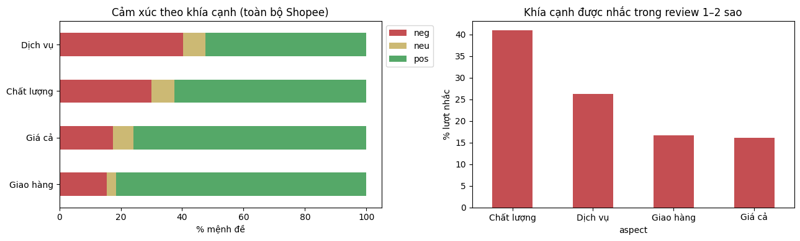{#fig-absa width=100%}

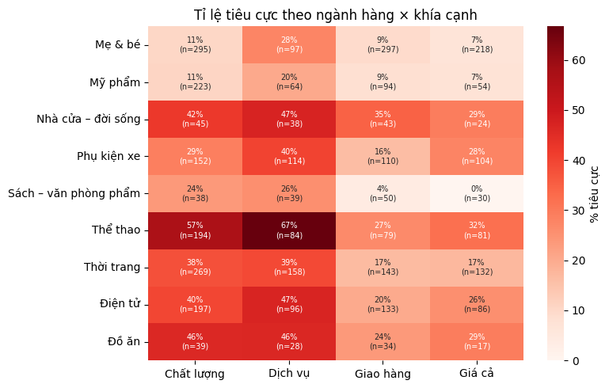{#fig-absa-heat width=80%}

# Sản phẩm mẫu, khả năng ứng dụng và hướng phát triển

## Thiết kế ứng dụng mẫu

<!-- Ảnh chụp 3 tab của app (figures/app_*.png), link online, link video. -->

[VIẾT]

## Ba vấn đề cần cải thiện

```{python}
#| label: tbl-issues
#| tbl-cap: "Các cặp ngành hàng × khía cạnh có nhiều lời chê nhất"
tbl("top_issue_candidates.csv", encoding="utf-8-sig")
```

[VIẾT: mỗi vấn đề gồm số liệu, 2–3 câu trích, hành động và KPI theo dõi.]

## Kế hoạch triển khai và theo dõi

[VIẾT: tích hợp vào quy trình CSKH; theo dõi data drift (phân bố độ dài, tỉ lệ từ mới, tỉ lệ dự đoán neg theo tuần) và model drift (gán tay 50 câu/tháng để đo F1).]

## Phản hồi người dùng thử nghiệm

[VIẾT: bảng phản hồi 3–5 người dùng.]

## Hạn chế và hướng phát triển

[VIẾT]

# Tài liệu tham khảo {.unnumbered}

::: {#refs}
:::
