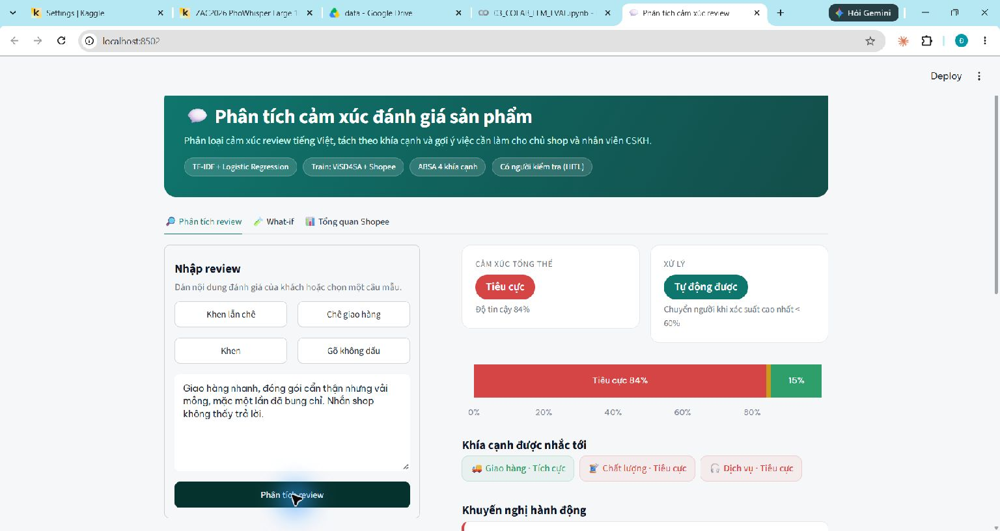
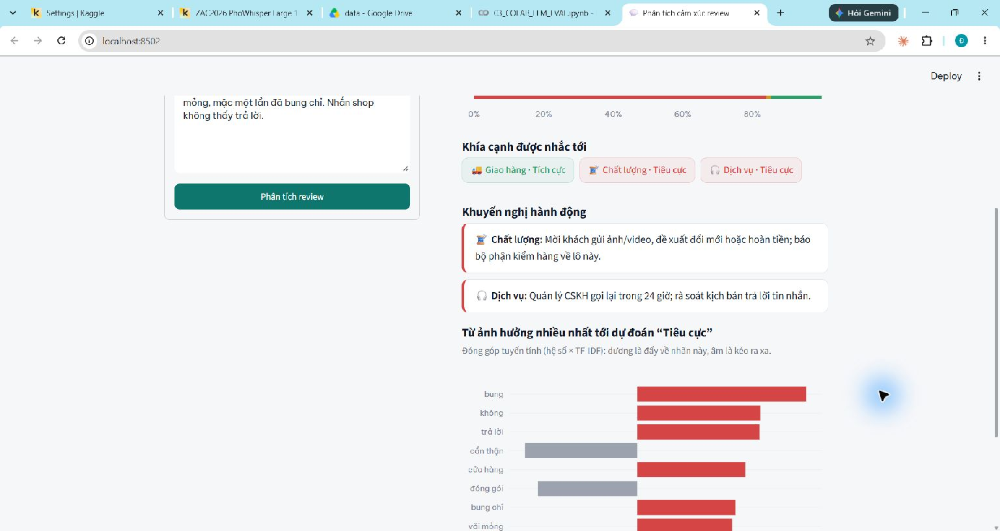
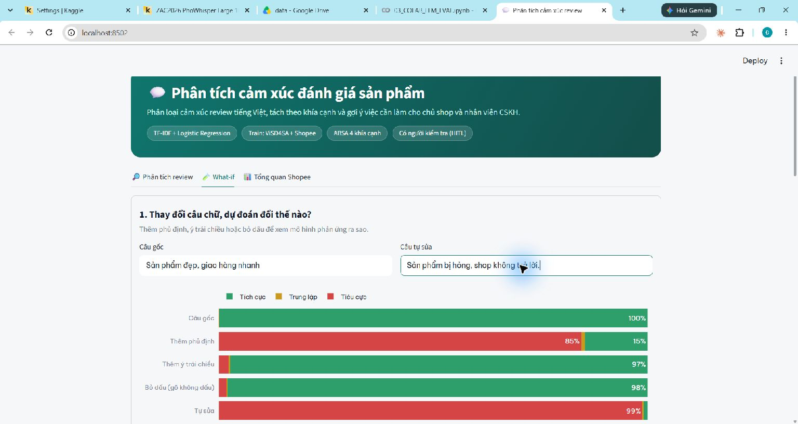
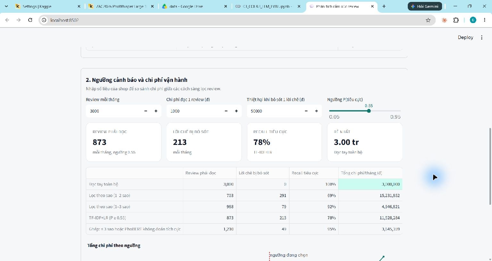
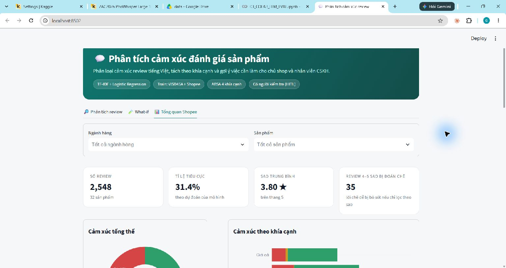

```{python}
import pandas as pd
from IPython.display import Markdown

REP, FIG = ".", "../figures"

def tbl(path, index=False, floatfmt=".3f", **kw):
    df = pd.read_csv(f"{REP}/{path}", **kw)
    return Markdown(df.to_markdown(index=index, floatfmt=floatfmt))
```

# Thông tin chung {.unnumbered}

**Trường:** Trường Đại học Quản lý và Công nghệ TP.HCM (UMT). **Khoa:** Khoa Công nghệ. **Năm:** 2026. **Mã đề tài:** Project 09.

**Giảng viên hướng dẫn:** Trần Mạnh Tường.

Đồ án do sinh viên thực hiện cá nhân.

## Bảng phân công nhiệm vụ {.unnumbered}

| Thành viên | MSSV | Phụ trách | Tỉ lệ hoàn thành |
|---|---|---|---|
| Đoàn Nguyễn Đăng Khoa | 2403700332 | Toàn bộ: dữ liệu và gán nhãn, tiền xử lý, mô hình, đánh giá, ứng dụng, báo cáo và demo | 100% |

## Danh mục từ viết tắt {.unnumbered}

| Viết tắt | Nghĩa |
|---|---|
| ABSA | Aspect-Based Sentiment Analysis – phân tích cảm xúc theo khía cạnh |
| CRISP-DM | Cross-Industry Standard Process for Data Mining |
| CV | Cross-Validation – kiểm định chéo |
| CSKH | Chăm sóc khách hàng |
| F1-macro | Trung bình F1 của các lớp, không trọng số |
| HITL | Human-in-the-loop – có con người trong vòng ra quyết định |
| LR | Logistic Regression |
| NB | Naive Bayes |
| PR-AUC | Diện tích dưới đường Precision–Recall |
| ROC-AUC | Diện tích dưới đường ROC |
| SHAP | SHapley Additive exPlanations |
| TF-IDF | Term Frequency – Inverse Document Frequency |
| XAI | Explainable AI – AI có thể giải thích |

## Lời cảm ơn và tuyên bố sử dụng AI {.unnumbered}

Nhóm xin cảm ơn giảng viên và ban giảng huấn học phần Trí tuệ Nhân tạo Ứng dụng & Khoa học Dữ liệu đã cung cấp kiến thức và tiêu chí thực hiện đề tài. Nhóm cũng ghi nhận đóng góp của các tác giả bộ dữ liệu ViSD4SA và các thư viện mã nguồn mở được sử dụng trong nghiên cứu.

**Tuyên bố sử dụng công cụ AI.** Claude (Anthropic) hỗ trợ xây dựng và sửa mã nguồn, notebook, ứng dụng, chuẩn bị báo cáo, gán ngành hàng sơ bộ và đề xuất nhãn cho 250 review train Shopee; người thực hiện đã duyệt và chỉnh sửa nhãn đề xuất. ChatGPT/Codex hỗ trợ phản biện mã nguồn và kết quả, đối chiếu rubric, soạn các đoạn phân tích còn thiếu và đề xuất phân nhóm lỗi. Nhãn tập vàng do người thực hiện gán thủ công; việc phân tích lỗi không thay đổi các nhãn đó. Người thực hiện chịu trách nhiệm kiểm tra số liệu, duyệt nhận định, xác nhận thông tin thực tế và làm chủ nội dung trước khi nộp. Persona và phương án triển khai là giả định thiết kế, không phải kết quả phỏng vấn; chi phí và ROI là mô phỏng, không phải doanh thu thực tế.

# Giới thiệu và xác định bài toán kinh doanh

## Bối cảnh thực tiễn và nỗi đau kinh doanh

Một cửa hàng trực tuyến cần biết khách đang không hài lòng về điều gì để phản hồi và sửa quy trình. Nếu chỉ xem điểm sao trung bình, cửa hàng khó phân biệt lỗi sản phẩm, giao hàng chậm hay phản hồi CSKH chưa tốt. Đọc toàn bộ nội dung giúp hiểu rõ hơn nhưng tốn thời gian; chỉ đọc review ít sao lại có thể bỏ sót lời chê nằm trong đánh giá nhiều sao.

Bộ dữ liệu Shopee dùng trong đồ án gồm 2.548 review (sau khi làm sạch) của 32 sản phẩm, chia thành 9 ngành hàng. Khi so 300 câu gán tay với nhãn suy từ số sao, hai cách gán chỉ trùng nhau ở 80,7% số câu. Đáng chú ý, trong 31 review 3 sao có tới 23 review thực chất là lời chê, và vẫn có review 4–5 sao phàn nàn (notebook 03). Vì thế số sao chỉ nên xem là nhãn yếu. Tuy vậy, dữ liệu chỉ gồm một số sản phẩm và tập vàng được lấy nhiều review ít sao hơn bình thường, nên các con số này không đại diện cho toàn bộ Shopee.

Bài toán đặt ra là giúp chủ shop và nhân viên CSKH lọc nhanh review, biết khách đang phàn nàn về khía cạnh nào và thấy được vấn đề nào cứ lặp đi lặp lại. Hệ thống phân loại review thành ba nhóm cảm xúc, gắn khía cạnh và gợi ý cách xử lý; nhân viên là người kiểm tra lại. Điều đồ án muốn cải thiện nhất là bớt bỏ sót lời chê. Còn đổi trả, bồi hoàn hay trả lời khách thì vẫn do con người quyết định.

## Chân dung người dùng và bản đồ thấu cảm

**Persona giả định – chị Lan, chủ một shop mỹ phẩm nhỏ trên Shopee.** Chị tự theo dõi đơn hàng và làm việc cùng một nhân viên CSKH. Điều chị cần là sớm phát hiện sản phẩm hay lô hàng có vấn đề, xử lý phản ánh kịp thời và biết chuyện nào nên chuyển cho kho, cho bên vận chuyển hay cho CSKH. Cái khó là khách hay vừa khen vừa chê trong cùng một review, viết tắt nhiều, và số sao nhiều khi không khớp với nội dung. Đây là nhân vật được dựng lên để phục vụ thiết kế, chưa qua phỏng vấn người thật.

| Nghĩ và cảm thấy | Nhìn thấy |
|---|---|
| Sợ bỏ sót những phản ánh nặng; muốn biết tại sao hệ thống gắn cờ một review thì mới yên tâm xử lý. | Lời khen ngắn nằm lẫn giữa những review rất dài; có review 5 sao nhưng vẫn chê giao hàng hoặc chất lượng. |
| **Nói và làm** | **Nghe thấy** |
| Hằng ngày lọc review 1–2 sao, đọc rồi nhắn cho khách, gửi ảnh hàng lỗi cho kho. Chị muốn có một bảng tổng hợp nhìn vào là hiểu. | Khách muốn được trả lời rõ ràng. Nhân viên thì hỏi nên làm việc nào trước, và vì sao. |

: Bản đồ thấu cảm cho persona giả định {#tbl-empathy}

**Nỗi đau:** không có thời gian đọc và phân loại từng review; khó tách phần khen và phần chê khi chúng nằm chung một câu; khó theo dõi một lỗi cứ lặp lại ở cùng sản phẩm. **Mong muốn:** một danh sách review cần xử lý trước, kèm nội dung gốc, nhãn và lý do; số liệu theo từng khía cạnh; thao tác đủ đơn giản để dùng mỗi ngày.

Giao diện cần hỗ trợ một review lẫn tệp dữ liệu, hiển thị khía cạnh cùng khuyến nghị và cho phép nhân viên kiểm tra trường hợp không chắc chắn. Các chức năng này chuyển nhu cầu nghiệp vụ thành tác vụ có thể kiểm thử.

## Phân loại bài toán AI và mục tiêu SMART

Bài toán thuộc nhóm **Insight** (tìm nguyên nhân hài lòng hoặc không hài lòng) kết hợp **Solution** (tự động phân loại và hỗ trợ sàng lọc). Về kỹ thuật, đây là phân loại văn bản ba lớp và phân tích cảm xúc theo bốn khía cạnh.

| Tiêu chí | Mục tiêu và cách kiểm tra |
|---|---|
| Specific | Phân loại tích cực, tiêu cực, trung lập; nhận diện Giao hàng, Chất lượng, Giá cả, Dịch vụ; cung cấp word cloud từng lớp, ba vấn đề ưu tiên và dashboard. |
| Measurable | Đối chiếu F1-macro ≥ 0,75 của đề, ghi riêng từng tập. Recall tiêu cực là chỉ số nghiệp vụ chính, luôn báo kèm F1-macro và lượng review cần đọc. Không đặt lại ngưỡng đạt theo điểm vàng đã xem. |
| Achievable | Dùng BoW+NB làm chuẩn; so sánh mô hình tuyến tính, Word2Vec và PhoBERT; tinh chỉnh bằng CV trên train hoặc ViSD4SA dev, phù hợp tài nguyên hiện có. |
| Relevant | Giảm bỏ sót lời chê và xác định bộ phận cần xử lý, đồng thời giữ quyền kiểm soát của nhân viên đối với phản hồi khách. |
| Time-bound | Hoàn thiện báo cáo, mã nguồn và minh chứng demo trước 23:59 ngày 11/11/2026; kiểm tra dữ liệu và kết quả trước khi đóng gói. |

: Mục tiêu SMART và tiêu chí kiểm tra {#tbl-smart}

Ở thời điểm viết báo cáo, PhoBERT đạt F1-macro 0,779 trên ViSD4SA test nhưng trên tập vàng Shopee chỉ được 0,704, với Recall tiêu cực 0,851. Tập vàng đã được xem trong lúc phát triển mô hình, nên các con số trên Shopee chỉ mang tính thăm dò. Nói cách khác, đồ án chưa chứng minh được F1-macro ≥ 0,75 trên Shopee, và cũng chưa có bằng chứng về hiệu quả khi triển khai thật.

## Ước tính hiệu quả kinh tế

```{python}
#| label: tbl-cost
#| tbl-cap: "Chi phí vận hành mỗi tháng của các chiến lược đọc review, đã hiệu chỉnh theo tỉ lệ sao (giả định trong notebook 09)"
df = pd.read_csv("cost_strategies.csv", index_col=0)
df = df[["Số review phải đọc/tháng", "Bỏ sót review chê/tháng", "Recall neg", "Tổng chi phí/tháng"]]
Markdown(df.to_markdown(floatfmt=(",.0f", ",.0f", ",.0f", ".2f", ",.0f")))
```

```{python}
#| label: tbl-roi
#| tbl-cap: "Độ nhạy ROI 12 tháng của chiến lược ghép, so với lọc 1–2 sao"
df = pd.read_csv("roi_sensitivity.csv", index_col=0)
Markdown((df * 100).round(0).astype(int).astype(str).add("%").to_markdown())
```

```{python}
#| label: tbl-roi-doc-tay
#| tbl-cap: "Độ nhạy ROI 12 tháng của chiến lược ghép, so với đọc tay toàn bộ"
df = pd.read_csv("roi_sensitivity_doc_tay.csv", index_col=0)
Markdown((df * 100).round(0).astype(int).astype(str).add("%").to_markdown())
```

Mô phỏng trong notebook 09 dựa trên các giả định sau: mỗi tháng có 3.000 review; đọc một review tốn 1.000 đồng; mỗi lời chê bị bỏ sót gây thiệt hại kỳ vọng 50.000 đồng; đầu tư ban đầu 15 triệu đồng và vận hành 500.000 đồng/tháng. Con số 1.000 đồng được tính từ 30 giây đọc với mức lương 120.000 đồng/giờ. Con số 50.000 đồng đến từ giả định 20% khách bị bỏ qua lời chê sẽ không quay lại, mỗi khách mang về 250.000 đồng lợi nhuận. Chưa giả định nào được đo ở doanh nghiệp thật.

Chi phí sàng lọc mỗi tháng bằng số review cần đọc nhân chi phí đọc, cộng số lời chê bỏ sót nhân thiệt hại kỳ vọng. ROI 12 tháng bằng (tiết kiệm trong 12 tháng trừ đầu tư) chia đầu tư; đầu tư gồm triển khai và vận hành. Tập vàng lấy dư review ít sao nên notebook dùng trọng số đưa phân bố sao về tập Shopee đã làm sạch. Hiệu chỉnh này không bảo đảm đại diện cho các cửa hàng khác.

Nhìn vào @tbl-cost, chiến lược ghép (đọc review từ 3 sao trở xuống, cộng thêm những review PhoBERT không xếp vào tích cực) cần đọc khoảng 1.210 review mỗi tháng và bỏ sót khoảng 49 lời chê, tổng cộng tốn khoảng 3,65 triệu đồng/tháng. Recall tiêu cực 0,949 sau hiệu chỉnh là của cả chiến lược ghép chứ không riêng PhoBERT; tính riêng PhoBERT trên tập vàng chưa hiệu chỉnh thì Recall tiêu cực là 0,851 và F1-macro 0,704. Đem so với cách chỉ lọc review 1–2 sao, chi phí mô phỏng giảm từ 15,23 xuống 3,65 triệu đồng/tháng, tương ứng ROI 12 tháng khoảng 562%.

Kết quả lại khác hẳn khi so với đọc tay toàn bộ. Theo giả định, đọc tay không bỏ sót lời chê nào và chỉ tốn 3 triệu đồng/tháng, nên chiến lược ghép có ROI khoảng −137%: khoản tiết kiệm không đủ bù tiền đầu tư và chi phí phát sinh. Ở quy mô 1.000 review/tháng với thiệt hại 25.000 đồng cho mỗi lời chê bỏ sót, ROI so với lọc 1–2 sao chỉ còn khoảng 6%. Trong bảng so với đọc tay, chỉ đúng một kịch bản cho ROI dương (khoảng 9%), là khi shop nhận 10.000 review/tháng và thiệt hại là 25.000 đồng. Như vậy không thể nói dùng AI lúc nào cũng rẻ hơn đọc tay.

Các phép so sánh trên dùng tập vàng đã xem, và mô hình ở đây chỉ để minh họa. Nếu một shop thật muốn đầu tư, việc đầu tiên nên làm là bấm giờ xem nhân viên đọc một review mất bao lâu, họ bỏ sót bao nhiêu lời chê và mỗi lời chê bỏ sót thiệt hại thực tế bao nhiêu; sau đó mới thử chiến lược trên dữ liệu mới của chính shop.

# Cơ sở lý thuyết và quy trình nghiên cứu

## Quy trình CRISP-DM

{#fig-crispdm width=100%}

| Giai đoạn | Việc trong đồ án | Notebook |
|---|---|---|
| Business Understanding | Persona, SMART, ROI | 09 |
| Data Understanding | EDA 3 nguồn dữ liệu | 01, 05 |
| Data Preparation | Làm sạch, chia theo sản phẩm, tiền xử lý, đặc trưng mới, tập vàng | 02, 03, 05 |
| Modeling | Baseline, TF-IDF + LR/SVC, Word2Vec, PhoBERT, tinh chỉnh | 04, 06, 07, 08 |
| Evaluation | F1, ROC/PR-AUC, chi phí, SHAP, fairness | 09 |
| Deployment | ABSA, dashboard Streamlit | 10, app |

: Ánh xạ CRISP-DM vào đồ án [@wirth2000crispdm] {#tbl-crispdm}

Quy trình không đi theo một chiều. Khi bước đánh giá phát hiện nhãn sai, đồ án quay lại bước chuẩn bị dữ liệu; khi ABSA gắn nhầm khía cạnh, từ điển được rà lại dựa trên dữ liệu train. Nhìn theo Design Thinking, persona thuộc bước Empathize và Define, việc so sánh ba cách làm (đọc tay, lọc theo sao, dùng mô hình) thuộc Ideate, còn dashboard là Prototype. Bước Test với người dùng thật nằm ngoài phạm vi đồ án, nên prototype mới chỉ được kiểm tra về mặt kỹ thuật.

## Các thuật toán sử dụng

**Bag-of-Words và Naive Bayes.** Mỗi văn bản được biểu diễn bằng số lần xuất hiện của từ và cụm từ. Multinomial Naive Bayes giả định các từ độc lập với nhau khi đã biết lớp, rồi dựa vào tần suất để đoán lớp. Mô hình này được chọn làm mốc so sánh vì đơn giản, huấn luyện nhanh, và nhờ nó mới biết được các mô hình phức tạp hơn có thực sự đáng công hay không.

**TF-IDF và Logistic Regression/LinearSVC.** TF-IDF giảm trọng số của từ phổ biến, tăng vai trò của từ phân biệt văn bản. LR học điểm số tuyến tính rồi chuyển thành xác suất các lớp; LinearSVC tìm biên phân tách và không cung cấp trực tiếp xác suất đã hiệu chỉnh. Unigram/bigram giữ một phần ngữ cảnh ngắn như cụm phủ định. Các mô hình phù hợp dữ liệu có nhãn còn ít và chạy trên CPU [@pedregosa2011sklearn].

**Word2Vec.** Ý tưởng của Word2Vec là những từ hay xuất hiện trong cùng ngữ cảnh sẽ có vector gần nhau. Đồ án dùng skip-gram, lấy trung bình vector của các từ trong review để có một vector cho cả review, sau đó đưa vào LR để phân loại. Vector được học trên văn bản train của A, B và Aug, còn bộ phân loại chỉ dùng nhãn của A+B. Cách này cho thấy mô hình nắm được quan hệ nghĩa giữa các từ đến đâu, nhưng khi lấy trung bình thì thứ tự từ bị mất và phạm vi của từ phủ định cũng dễ bị nhòe [@mikolov2013word2vec].

**PhoBERT.** PhoBERT là mô hình ngôn ngữ được huấn luyện sẵn cho tiếng Việt, trong đó vector của một từ thay đổi theo câu chứa nó [@nguyen2020phobert]. Đồ án fine-tune PhoBERT cho bài toán ba lớp trên dữ liệu A+B, chọn learning rate và checkpoint dựa vào ViSD4SA dev. So với TF-IDF, PhoBERT tận dụng được ngữ cảnh rộng hơn nhiều, bù lại tốn tài nguyên hơn cả khi huấn luyện lẫn khi chạy.

**ABSA kết hợp từ điển và mô hình.** ABSA tách việc tìm khía cạnh khỏi việc xác định cảm xúc dành cho khía cạnh đó [@pontiki2014semeval]. Trong đồ án, mỗi review được cắt thành các mệnh đề; mệnh đề nào chứa từ khóa của một trong bốn khía cạnh thì được gắn khía cạnh đó. Cảm xúc của mệnh đề do TF-IDF+LR dự đoán, có thêm luật nhận diện cụm chê và từ phủ định. Khi một khía cạnh xuất hiện ở nhiều mệnh đề mang nhãn khác nhau với số lần ngang nhau, nhãn tiêu cực được ưu tiên. Đây là cách làm heuristic do đồ án tự xây dựng, không phải mô hình có giám sát như trong bài báo tham khảo.

**Giải thích tuyến tính theo SHAP.** SHAP chia đầu ra của mô hình thành phần đóng góp của từng đặc trưng [@lundberg2017shap]. Với LR, đóng góp của một từ bằng hệ số của từ đó nhân với độ chênh giữa giá trị TF-IDF trong câu và giá trị trung bình trên train. Cộng các đóng góp với giá trị nền sẽ ra logit, nên những con số này không phải phần trăm xác suất. Cách tính coi các đặc trưng là độc lập, trong khi một từ và bigram chứa nó thường đi cùng nhau; đây vẫn là điểm hạn chế.

# Khám phá và tiền xử lý dữ liệu

## Nguồn dữ liệu và từ điển dữ liệu

```{python}
#| label: tbl-sources
#| tbl-cap: "Ba nguồn dữ liệu và vai trò"
tbl("data_sources.csv")
```

ViSD4SA là bộ review điện thoại được gán nhãn cảm xúc ở mức cụm từ và khía cạnh [@phan2021visd4sa]. Notebook 02 gộp các nhãn đó thành một nhãn cho cả câu theo quy tắc viết sẵn, đồng thời giữ nguyên cách chia train/dev/test của nguồn; sau làm sạch còn 10.510 câu. Vì đồ án phân loại cả câu, kết quả ở đây không đặt cạnh được điểm ABSA trong bài báo gốc.

Shopee là tệp CSV có sẵn trong dự án, ban đầu gồm 2.843 review của 32 sản phẩm; không coi việc đọc tệp là minh chứng tự thu thập bằng crawler. Sau làm sạch còn 2.548 review. Dữ liệu có văn bản, sản phẩm và sao; ngành hàng gán theo từ khóa tên sản phẩm. Aug có 1.205 câu sau lọc, chỉ có hai lớp và chưa xác minh đầy đủ nguồn gốc, nên chỉ dùng trong thí nghiệm train, không làm tập kiểm định.

Tên `gold_500.csv` phản ánh kế hoạch ban đầu; hiện có 300 câu gán cảm xúc, trong đó 200 câu đủ nhãn bốn khía cạnh (notebook 03). Không lấy số 500 trong tên file làm cỡ mẫu đánh giá.

```{python}
#| label: tbl-dict
#| tbl-cap: "Từ điển dữ liệu"
md = pd.read_csv("data_dictionary.csv", encoding="utf-8-sig").to_markdown(index=False).split("\n")
md[1] = "|" + "|".join("-" * w for w in [9, 15, 20, 28, 28]) + "|"   # độ rộng tương đối của từng cột
Markdown("\n".join(md))
```

## Phân tích khám phá và phát hiện kinh doanh

{#fig-target width=100%}

Phân phối sao lệch trái với skewness −0,86, tập trung về phía nhiều sao. Độ dài review lệch phải mạnh (4,12); sau log1p, skewness còn −0,03. Trung vị độ dài ở 1 sao là 23 từ, trong khi 5 sao là 19 từ (notebook 05). Điểm sao cao không có nghĩa không có phản ánh cần xử lý. Review dài có thể chứa nhiều thông tin nên không loại chỉ vì dài; log độ dài giúp giảm ảnh hưởng của văn bản quá dài khi tạo đặc trưng, không phải quy tắc xác định cảm xúc.

{#fig-category width=85%}

Thể thao có tỷ lệ nhãn sao tiêu cực cao nhất trong mẫu (48,5%), tiếp đến Đồ ăn (34,4%); Mỹ phẩm và Mẹ & bé thấp hơn (6,1% và 6,8%). Đây là nhãn suy từ sao, khác cảm xúc do người hoặc mô hình xác định từ văn bản. Chênh lệch gợi ý ưu tiên đọc lại nhóm có nhiều phản ánh, nhưng không đủ để kết luận chất lượng cả ngành: cơ cấu sản phẩm và cỡ mẫu không đồng đều, một số ngành chỉ có một sản phẩm.

{#fig-corr width=65%}

Số từ phủ định tương quan âm mạnh nhất với sao (Spearman −0,478), tiếp theo là từ đối lập như “nhưng” (−0,312). Độ dài tương quan âm yếu hơn (−0,166); tỷ lệ chữ hoa (−0,009) và dấu chấm than (0,020) gần như không có quan hệ đơn điệu. Kết quả ủng hộ giữ tín hiệu phủ định và cấu trúc khen–chê, nhưng tương quan không chứng minh nguyên nhân hay bảo đảm tăng điểm mô hình. Đặc trưng chỉ tính từ văn bản; sao dùng đối chiếu EDA, không làm đầu vào dự đoán.

{#fig-wc width=100%}

Word cloud dùng Shopee train với nhãn sao ban đầu, mô tả cách dùng từ trước gán lại; không phải word cloud của tập vàng hoặc PhoBERT. Kích thước từ thể hiện tần suất sau bỏ từ chung, không phải độ nghiêm trọng khiếu nại. Một từ có thể xuất hiện ở cả lời khen lẫn chê nên cần đọc lại ngữ cảnh. Việc bỏ từ chung, kể cả phủ định, khỏi riêng word cloud không đồng nghĩa bỏ khỏi đầu vào mô hình.

```{python}
#| label: tbl-star-label
#| tbl-cap: "Nhãn tay theo số sao trên 300 câu vàng (notebook 03)"
g = pd.read_csv("../labeling/gold_500.csv", encoding="utf-8-sig")
meta = pd.read_csv("../data/processed/shopee_gold_pool.csv")
g = g[g.sentiment.isin(["neg", "neu", "pos"])].merge(meta[["id", "rating"]], on="id", validate="one_to_one")
Markdown(pd.crosstab(g.rating, g.sentiment, margins=True).to_markdown())
```

Trong 31 review 3 sao ở @tbl-star-label, chỉ 6 câu gán trung lập, trong khi 23 câu tiêu cực. Một số review 4–5 sao cũng là lời chê. Điều này giải thích vì sao không đánh đồng số sao với cảm xúc. Do mẫu lấy dư review ít sao, không suy ra tỷ lệ khiếu nại của toàn sàn.

## Chuẩn bị dữ liệu

```{python}
#| label: tbl-cleaning
#| tbl-cap: "Số dòng sau từng bước làm sạch dữ liệu Shopee"
tbl("../data/processed/cleaning_steps.csv")
```

```{python}
#| label: tbl-preprocess
#| tbl-cap: "Ảnh hưởng của các bước tiền xử lý (TF-IDF + LR, train A+B, F1-macro)"
tbl("preprocess_ablation.csv")
```

Notebook 02 loại các đoạn rác lấy nhầm từ giao diện (“Tổng quan/Trợ lý AI tổng hợp”), bỏ nhãn mục theo mẫu, chuẩn hóa văn bản, khử trùng và loại review quá ngắn theo quy tắc đặt trước. Sau bước này Shopee còn 2.548 trên 2.843 dòng. Khi chia theo sản phẩm, 22 sản phẩm thuộc train và 10 sản phẩm thuộc kho vàng; bỏ thêm 8 câu train trùng nội dung với kho vàng, train còn 1.794 câu. Review dài không bị loại chỉ vì dài bất thường; một review có phải rác hay không được xét theo nội dung. Riêng PhoBERT chỉ đọc được một số token đầu, nên với review quá dài, ý ở cuối có thể bị cắt mất.

Shopee được chia theo sản phẩm để review của cùng một mặt hàng không vừa nằm trong train vừa nằm trong tập đánh giá. ViSD4SA không có mã sản phẩm đầy đủ như Shopee, nên đồ án giữ nguyên cách chia của nguồn và không nói rằng nguồn này cũng được chia theo sản phẩm. Từ vựng, IDF và bước chuẩn hóa đặc trưng đều nằm trong pipeline, nên ở mỗi fold chúng chỉ được học từ phần train. Aug chỉ được thêm vào train. Cũng cần nói rõ: lọc trùng chỉ bắt được câu giống hệt, còn câu viết lại gần nghĩa vẫn có thể lọt qua.

Đặc trưng mới gồm độ dài log, số từ phủ định, số từ đối lập, dấu chấm than, tỷ lệ chữ hoa và tỷ lệ ký tự có dấu. Hiệu quả phải kiểm tra bằng CV, không suy từ tương quan. Tiền xử lý chuẩn hóa Unicode, teencode, ký tự lặp, đổi emoji thành token và tách từ; từ phủ định được giữ ở biến thể bỏ stopword.

Theo @tbl-preprocess, F1-macro ViSD4SA test lần lượt là 0,713 (thô), 0,713 (chuẩn hóa), 0,720 (thêm tách từ) và 0,727 (thêm bỏ stopword). Trên vàng Shopee: 0,608; 0,637; 0,619; 0,591. Ablation này dùng cấu hình riêng của notebook 07, không phải kết quả sau tuning notebook 06. Có thể thấy cùng một bước tiền xử lý nhưng tác động lên hai miền dữ liệu lại khác nhau. Pipeline không được chọn lại dựa trên điểm vàng hay điểm test. Tập vàng chỉ một người gán nên còn hạn chế về độ tin cậy.

### Gán lại nhãn cho review 3–4 sao

Ban đầu, nhãn của Shopee train được suy ra từ số sao: 1–2 sao là tiêu cực, 3 sao là trung lập, 4–5 sao là tích cực. Để giảm nhiễu, 250 review được gán lại, gồm toàn bộ 192 review 3 sao và 58 review 4 sao chọn ngẫu nhiên. Claude đề xuất nhãn dựa trên `labeling/guideline.md` mà không được xem số sao; sau đó người thực hiện đọc lại từng câu, sửa 50 nhãn và bỏ 6 câu rác. Kết quả là 178 câu mang nhãn khác với nhãn theo sao, và số câu tích cực/tiêu cực/trung lập của Shopee train đổi từ 1.165/437/192 sang 1.153/591/44. Trong bảng so sánh dưới đây, tham số của các mô hình cổ điển được giữ nguyên; kết quả chính ở các phần sau thì đã tinh chỉnh lại bằng notebook 06. PhoBERT cũng được chạy lại quy trình chọn learning rate trên ViSD4SA dev, và hai lần chạy chọn ra hai learning rate khác nhau. Từ đây trở đi, mọi kết quả đều dùng nhãn gán lại. Do tập vàng đã được xem trước thí nghiệm này, số trên tập vàng chỉ mang tính thăm dò.

```{python}
#| label: tbl-relabel
#| tbl-cap: "So sánh nhãn theo sao và nhãn gán lại (train A+B; cột Vàng là tập vàng Shopee, chỉ thăm dò)"
d = pd.read_csv("relabel_summary.csv")
d = d.pivot_table(index=["Mô hình", "Nhãn train"], columns="Tập", values=["F1-macro", "Recall neg"], sort=False)
ten_tap = {"Vàng Shopee (thăm dò)": "Vàng", "ViSD4SA test": "ViSD test"}
d.columns = [f"{'F1' if m == 'F1-macro' else 'Recall neg'} {ten_tap.get(t, t)}" for m, t in d.columns]
md = d.reset_index().to_markdown(index=False, floatfmt=".3f").split("\n")
md[1] = "|:" + "-" * 24 + "|:" + "-" * 14 + "|" + "|".join("-" * 12 + ":" for _ in range(4)) + "|"   # cột tên mô hình rộng hơn
Markdown("\n".join(md))
```

Review 3 sao có thể là lời chê rõ hoặc ý kiến pha trộn, nên gán mặc định trung lập tạo nhiễu. Gán theo nội dung phù hợp mục tiêu phát hiện phản ánh hơn, nhưng Shopee train sau gán lại chỉ còn 44 câu trung lập; cần bổ sung dữ liệu thật cho lớp này.

Trong @tbl-relabel, PhoBERT đổi Recall tiêu cực ViSD4SA test từ 0,914 lên 0,923, nhưng F1-macro giảm từ 0,808 xuống 0,779. Trên vàng Shopee đã xem, Recall tiêu cực tăng từ 0,595 lên 0,851, F1-macro từ 0,617 lên 0,704; chỉ mang tính thăm dò. Người thực hiện chọn nhãn gán lại để phản ánh nội dung và ưu tiên lời chê, không coi điểm tăng trên vàng là kiểm định độc lập.

Vì hai lần chạy PhoBERT chọn learning rate khác nhau, không thể quy hết phần chênh lệch cho việc đổi nhãn. Cấu hình trên Colab cũng không ghi lại đủ thông tin về tệp train, nên không xác minh chắc chắn được mô hình đã học từ tệp nào. Riêng câu stt 108, ô nhãn ghi một nhận xét thay vì nhãn và script đang hiểu đó là tiêu cực; nhãn này cần người gán xác nhận. Các giới hạn trên được giữ nguyên trong báo cáo: nhãn không bị sửa và mô hình không được huấn luyện lại chỉ để điểm đẹp hơn.

# Thiết kế, huấn luyện và tối ưu mô hình

## Mô hình cơ sở và kiểm định chéo theo sản phẩm

```{python}
#| label: tbl-cv
#| tbl-cap: "Kết quả GroupKFold 5 fold theo sản phẩm trên Shopee train (F1-macro)"
tbl("cv_results.csv")
```

BoW+NB đạt F1-macro CV 0,601 ± 0,017 trên Shopee train; TF-IDF+LR đạt 0,665 ± 0,046, LinearSVC 0,658 ± 0,061. Các mô hình dùng cùng GroupKFold theo sản phẩm, phù hợp nhu cầu xử lý mặt hàng chưa có trong train hơn chia ngẫu nhiên từng review. Vectorizer được fit bên trong pipeline mỗi fold.

Cùng cấu hình LR, StratifiedKFold xáo ngẫu nhiên cho 0,673 ± 0,041, so với GroupKFold 0,665 ± 0,046 (notebook 06). Chênh lệch nhỏ và độ lệch chuẩn chồng lấn, không định lượng chắc chắn mức rò rỉ. Chọn chia theo sản phẩm vì phù hợp thiết kế đánh giá, không phải vì chia ngẫu nhiên luôn tăng điểm nhiều. CV đồng thời dùng chọn tham số nên điểm CV tối ưu chưa phải ước lượng độc lập sau chọn mô hình.

## Tinh chỉnh siêu tham số và chống quá khớp

{#fig-lc width=100%}

GridSearchCV thử các giá trị của C, min_df và việc dùng unigram hay thêm bigram. Cấu hình được chọn cho LR là C=10, min_df=2, n-gram (1,2); LinearSVC chọn C=1 với cùng cấu hình từ vựng. Tham số C quyết định mức điều chuẩn, min_df bỏ bớt từ quá hiếm, còn class weight balanced giúp các lớp ít mẫu không bị lấn át. Khi thêm các đặc trưng nghiệp vụ, F1-macro CV lại giảm còn 0,631 so với 0,665 của LR thuần. Như vậy, dù các đặc trưng này tương quan rõ với số sao trong EDA, chúng chưa giúp mô hình tốt hơn.

Trên learning curve, F1 trên train luôn bằng 1,000 trong khi F1 validation thấp hơn hẳn. Khi tăng số mẫu train từ 198 lên 1.322, F1 validation của LR tăng từ 0,534 lên 0,665, của SVC từ 0,536 lên 0,656. Khoảng cách giữa train và validation vẫn lớn, tức là mô hình còn quá khớp. Đường validation vẫn đang đi lên nên thêm dữ liệu đa dạng là hướng đáng thử, dù không chắc điểm sẽ tiếp tục tăng. Điều chuẩn và CV theo sản phẩm giúp kết quả đánh giá bớt lạc quan, nhưng không có nghĩa là đã hết quá khớp.

Với PhoBERT, đồ án thử hai learning rate 2e-5 và 3e-5 rồi chọn theo F1-macro trên ViSD4SA dev. Không chạy CV năm fold vì tốn GPU, nên không so được độ dao động của PhoBERT với các mô hình cổ điển. Log huấn luyện cho thấy ở epoch cuối train loss vẫn giảm nhưng dev loss đã tăng. Checkpoint được chọn theo F1, nhưng điều đó không có nghĩa là mô hình không quá khớp nếu xét theo loss. Người chạy lại thí nghiệm cần biết checkpoint được chọn theo tiêu chí nào và lưu ý giới hạn này.

## So sánh các mô hình và nguồn huấn luyện

```{python}
#| label: tbl-tuned
#| tbl-cap: "F1-macro trên tập vàng Shopee theo nguồn train (thăm dò)"
d = pd.read_csv("tuned_results.csv")
Markdown(d.pivot(index="model", columns="train", values="F1_gold").to_markdown(floatfmt=".3f"))
```

```{python}
#| label: tbl-w2v
#| tbl-cap: "Kết quả Word2Vec (vector học trên A+B+Aug, bộ phân loại LR huấn luyện trên A+B)"
tbl("word2vec_results.csv")
```

Trên ViSD4SA test, thêm A vào B làm F1-macro TF-IDF+LR tăng từ 0,510 lên 0,720; trên vàng Shopee gần như không tăng (0,608 và 0,612). Đây là khác biệt miền/phân bố nhãn, không chứng minh thêm dữ liệu luôn tốt. Kết quả Aug chỉ là ablation, không dùng thay mô hình chính theo điểm vàng.

Word2Vec+LR chọn C=1 dựa trên ViSD4SA dev (F1-macro 0,635, bằng C=10; khi hòa thì chọn C nhỏ hơn, tức điều chuẩn mạnh hơn), đạt 0,629 trên ViSD4SA test và 0,620 trên vàng Shopee (thăm dò). Trên ViSD4SA test, kết quả này kém TF-IDF+LR. Một lý do có thể là khi lấy trung bình vector, thứ tự từ và từ phủ định bị mất, nhưng thí nghiệm chưa tách riêng để kiểm chứng. Điểm vàng không được dùng để chọn C.

# Đánh giá chuyên sâu, giải thích mô hình và đạo đức AI

## Chỉ số kỹ thuật

```{python}
#| label: tbl-main
#| tbl-cap: "Kết quả vàng Shopee (thăm dò); dòng cuối là F1-macro ViSD4SA test"
d = pd.read_csv("main_results.csv", index_col=0)
Markdown(d.T.to_markdown(floatfmt=".3f"))
```

```{python}
#| label: tbl-ci
#| tbl-cap: "Khoảng bootstrap 95% F1-macro trên vàng Shopee (thăm dò)"
tbl("bootstrap_ci.csv")
```

{#fig-eval width=100%}

Recall tiêu cực được chọn làm chỉ số nghiệp vụ chính vì nó cho biết mô hình tìm ra được bao nhiêu phần lời chê. Tuy nhiên Recall có thể tăng rất dễ nếu mô hình gán tiêu cực cho quá nhiều câu hoặc bỏ mặc lớp trung lập, nên F1-macro luôn được báo kèm. Accuracy ít ý nghĩa ở đây vì bị lớp đông nhất chi phối. PR-AUC cho thấy Precision và Recall đánh đổi nhau thế nào khi thay ngưỡng; ROC-AUC OvR và các chỉ số macro giúp nhìn thêm khả năng phân biệt cả ba lớp.

Trên vàng Shopee, PhoBERT có Recall tiêu cực 0,851, F1-macro 0,704, Accuracy 0,837. TF-IDF+LR dùng trong dashboard có Recall tiêu cực 0,835, F1-macro 0,612; không gán điểm PhoBERT cho app chạy LR. Trên ViSD4SA test, PhoBERT đạt F1-macro 0,779, LR đạt 0,720. Mục tiêu 0,75 chỉ đạt ở PhoBERT trên ViSD4SA test.

Xét tiêu cực là lớp cảnh báo: dương tính giả là review không tiêu cực bị đưa cho nhân viên đọc; âm tính giả là lời chê bị bỏ qua. Theo giả định chi phí, dương tính giả phát sinh công đọc, âm tính giả có thể mất cơ hội giữ khách. Recall cao có ý nghĩa nghiệp vụ nhưng cần kiểm soát Precision và số review phải đọc để tránh quá tải.

Khoảng bootstrap của PhoBERT là [0,640; 0,767], thể hiện mức dao động khi lấy mẫu lại từ chính dữ liệu đang có. Notebook 09 lấy mẫu theo từng câu, trong khi các câu cùng sản phẩm thường giống nhau, nên khoảng này có thể hẹp hơn thực tế. Khoảng tin cậy cũng không khắc phục được việc tập vàng đã bị xem, và không chứng minh mô hình vượt 0,75. Việc chọn mô hình để vẽ ma trận nhầm lẫn, tính chi phí và HITL đều dựa vào bảng điểm vàng, vì vậy các phân tích tiếp theo là xem xét lại sau khi đã có kết quả, không phải quy trình chọn mô hình để triển khai.

{#fig-cost width=75%}

@fig-cost cho thấy khi hạ ngưỡng cảnh báo, nhân viên phải đọc nhiều review hơn nhưng số lời chê bị bỏ sót có thể giảm. Đường chi phí và điểm thấp nhất trên hình được tính trên tập vàng đã xem, nên không thể dùng làm ngưỡng triển khai. Muốn chọn ngưỡng thật, cần một tập phát triển riêng, cân theo số nhân viên CSKH hiện có, rồi kiểm tra lại trên một tập khóa chưa từng dùng tới.

## Giải thích mô hình

{#fig-shap-global width=70%}

{#fig-shap-local width=100%}

Ở @fig-shap-local, TF-IDF+LR đoán đúng câu tiêu cực trong ví dụ đầu nhưng bỏ lọt câu chê đóng gói ở ví dụ thứ hai: xác suất tiêu cực của câu này chỉ khoảng 0,08. Những từ như “cũng” và “rẻ” kéo logit tiêu cực xuống, cho thấy mô hình đang dựa khá nhiều vào từng từ đơn lẻ. Ví dụ thứ ba là một câu tích cực có chứa từ phủ định, nhắc rằng phải xem từ phủ định đang phủ định điều gì. Ba ví dụ chỉ để minh họa cách LR hoạt động trên tập vàng đã xem; chúng không cho biết lỗi này xảy ra thường xuyên đến mức nào.

Ở @fig-shap-global, “không”, “tệ”, “bị” có hệ số hướng về tiêu cực; “ổn”, “tốt”, “đẹp” hướng ngược lại. Điều này phù hợp tín hiệu thường gặp nhưng có ngoại lệ như “không tệ”. Hình tổng thể dùng trung bình trị tuyệt đối đóng góp, còn màu theo hệ số; màu không mô tả dấu đóng góp của mọi câu.

Khi giải thích một câu cụ thể, cần nhớ mọi đóng góp đều được so với mức nền trung bình của train. Vì vậy một từ không có trong câu vẫn có đóng góp khác 0, do TF-IDF của nó thấp hơn mức nền. Thấy một cột đỏ mang tên một từ khen cũng không có nghĩa là từ đó làm câu thành tiêu cực. SHAP chỉ cho biết LR dùng đặc trưng ra sao; nó không xác nhận khách nói đúng hay chứng minh quan hệ nhân quả. Một rủi ro khác là tên sản phẩm có thể trở thành lối tắt nếu trong train sản phẩm đó luôn đi với một nhãn. Chia dữ liệu theo sản phẩm và xem lỗi trên sản phẩm mới giúp phát hiện điều này.

Dashboard dùng tích hệ số với TF-IDF để phản hồi nhanh, chưa trừ nền trung bình như notebook; cần gọi là đóng góp tuyến tính. Nhân viên nên xem đóng góp cùng review gốc, khía cạnh và mức chắc chắn thay vì dựa riêng một từ.

## Đạo đức AI và rủi ro vận hành

```{python}
#| label: tbl-fair
#| tbl-cap: "Hiệu năng theo ngành hàng"
d = pd.read_csv("fairness_category.csv", encoding="utf-8-sig")
d["% neg thật"] = d["% neg thật"] * 100
Markdown(d.to_markdown(index=False, floatfmt=".3f"))
```

{#fig-unaccent width=75%}

```{python}
#| label: tbl-hitl
#| tbl-cap: "Đánh đổi khi chuyển câu không chắc chắn cho nhân viên (Human-in-the-loop)"
d = pd.read_csv("hitl.csv")
d["% chuyển người"] = d["% chuyển người"] * 100
Markdown(d.to_markdown(index=False, floatfmt=".3f"))
```

Trên vàng, PhoBERT có F1-macro 0,588 và Recall tiêu cực 0,850 ở Phụ kiện xe (33 câu), so với 0,804 và 1,000 ở Điện tử (26 câu). Cỡ mẫu nhỏ và cơ cấu nhãn khác nhau nên chưa chứng minh công bằng/bất công với nhóm người. Sách–văn phòng phẩm chỉ có 6 câu, không có nhãn tiêu cực: Recall ghi 0 theo quy ước zero_division, không phải bỏ sót toàn bộ lời chê. Ngành không có trong mẫu cũng chưa được đánh giá.

Trong thí nghiệm LR ở notebook 07, khi bỏ dấu, F1-macro giảm từ 0,720 xuống 0,472 trên ViSD4SA test và từ 0,619 xuống 0,447 trên vàng. Thêm Aug vào train giúp F1 trên vàng không dấu lên 0,537, nhưng với ViSD4SA không dấu thì gần như không đổi (0,465). Vì Aug chưa rõ nguồn và tập vàng đã xem, các con số này chỉ mang tính thăm dò. Dữ liệu không có thông tin về tuổi, thiết bị hay nhóm xã hội, nên báo cáo không suy ra ai là người hay gõ không dấu. Muốn đánh giá đúng, cần văn bản không dấu có nguồn gốc rõ ràng và một mẫu đánh giá riêng.

Về quyền riêng tư, khi demo nên dùng văn bản đã xóa tên, số điện thoại, địa chỉ và thông tin giao dịch; mô hình phân loại cũng không cần thêm thông tin định danh nào. Tệp gốc và tệp kết quả cần được phân quyền truy cập, hạn chế lưu nội dung người dùng nhập và có quy trình xóa khi cần. Một review công khai trên sàn vẫn có thể chứa thông tin cá nhân. Với dữ liệu do AI hỗ trợ tạo hoặc gán nhãn, cần ghi rõ nguồn và người duyệt. Aug không thể thay cho nhãn thật, nhất là với lớp trung lập.

HITL chuyển câu có xác suất cao nhất dưới ngưỡng cho nhân viên. Mức minh họa 0,8 trong @tbl-hitl chuyển 7,3% câu; phần tự động có F1-macro 0,722, Recall tiêu cực 0,907. Đây là chỉ số trên phần giữ lại, không phải toàn hệ thống hoặc chất lượng xử lý của nhân viên. Chưa kiểm định hiệu chỉnh xác suất/ngưỡng độc lập. Câu tự tin cao vẫn có thể sai nên cần lấy mẫu kiểm tra cả nhóm này, ưu tiên phản ánh chất lượng/an toàn và nhiều khía cạnh trái chiều.

## Phân tích lỗi

Notebook 09 lấy ngẫu nhiên tối đa 40 dự đoán khác nhãn tay của PhoBERT. Codex đọc nội dung, đề xuất một nhóm chính mỗi câu; đây là diễn giải thăm dò cần người thực hiện duyệt, không phải nhãn lỗi đã đo đồng thuận. Nhãn cảm xúc và dự đoán được giữ nguyên. Một câu có thể có nhiều nguyên nhân; nhóm chính giúp sắp xếp việc rà soát.

```{python}
#| label: tbl-errors
#| tbl-cap: "Phân nhóm 40 trường hợp khác nhãn tay (Codex đề xuất, thăm dò)"
tbl("error_group_summary.csv", floatfmt=".1f")
```

Nhóm khen–chê nhiều khía cạnh/thời điểm có 13 câu. `shp_2329` khen giao hàng nhưng không vừa ý mùi nước hoa; một nhãn chung dễ làm mất lời chê cụ thể. Năm câu chưa trải nghiệm đủ/kỳ vọng, như `shp_0444` (“Trước mắt thấy ok Về lâu dài thì sử dụng mới biết”), cho thấy ranh giới trung lập và tích cực còn khó.

Có 11 câu mà chính nhãn tay mới là chỗ đáng nghi, nên chưa thể nói mô hình đúng hay sai. Chẳng hạn `shp_2436` viết “quá tuyệt, thơm lâu.” mà lại mang nhãn tiêu cực, còn `shp_1446` viết “Sản phẩm ko lên pin” mà nhãn là trung lập. Những câu này cần người gán đọc lại theo hướng dẫn và ngữ cảnh gốc. Nếu sửa nhãn xong rồi báo điểm tăng trên chính tập đã xem, đó chỉ là hậu kiểm chứ không phải mô hình tiến bộ trên dữ liệu mới.

Các nhóm còn lại nhỏ hơn: teencode và lỗi chính tả (4 câu), câu ngắn theo mẫu (3), nội dung nhiễu hoặc không nói về trải nghiệm (2), so sánh ngầm (1) và câu có phủ định nhưng không phải lời chê (1). Ví dụ `shp_1048` là một đoạn văn dài tả chim bồ câu, còn `shp_0473` không chê trực tiếp mà so sánh với một thương hiệu khác. Hướng xử lý là lọc nhiễu, thống nhất cách gán nhãn và thêm ví dụ vào train, sau đó đánh giá trên một tập mới. Các tỷ lệ trong bảng chỉ tính trên 40 câu bất đồng được chọn, không phải tỷ lệ lỗi trên toàn bộ review.

## Kết quả phân tích theo khía cạnh

```{python}
#| label: tbl-absa-eval
#| tbl-cap: "Đánh giá ABSA trên 200 câu vàng có nhãn khía cạnh (thăm dò)"
tbl("absa_eval.csv", encoding="utf-8-sig")
```

Ở bước phát hiện khía cạnh, F1 đạt 0,764 với Giao hàng, 0,763 với Chất lượng, 0,658 với Giá cả và 0,611 với Dịch vụ. Chất lượng có Precision rất cao (0,958) nhưng Recall chỉ 0,633: hễ đã gắn thì thường đúng, nhưng còn bỏ sót nhiều cách khách diễn đạt mà từ điển chưa có. Dịch vụ thì ngược lại, Precision chỉ 0,519, nghĩa là gắn nhầm khá nhiều. Độ chính xác cảm xúc trong bảng chỉ tính trên những lần đã tìm đúng khía cạnh, nên chưa phản ánh chất lượng của cả quy trình. Vì một câu có thể nhắc nhiều khía cạnh, tổng số lượt nhắc lớn hơn 200. Đánh giá này làm trên tập vàng đã xem nên chỉ mang tính thăm dò.

{#fig-absa width=100%}

{#fig-absa-heat width=80%}

Chạy trên toàn bộ dữ liệu Shopee đã làm sạch, hệ thống tìm thấy 1.501 lượt nhắc Chất lượng, trong đó 40,1% bị dự đoán là tiêu cực; Dịch vụ được nhắc 729 lượt nhưng tỷ lệ tiêu cực lên tới 52,5% (`aspect_summary.csv`). Hai con số này trả lời hai câu hỏi khác nhau: khía cạnh nào được nhắc nhiều thì cho biết khối lượng việc cần xử lý, còn khía cạnh nào có tỷ lệ chê cao thì cho biết vấn đề đang dồn vào đâu. Heatmap giúp khoanh vùng những chỗ nên đọc lại trước; những ô có ít lượt nhắc thì chưa đủ ổn định để xếp hạng. Cũng cần lưu ý thống kê này gồm cả review đã dùng để train và dựa trên nhãn dự đoán, nên không phải tỷ lệ hàng lỗi thật.

# Sản phẩm mẫu, khả năng ứng dụng và hướng phát triển

## Thiết kế ứng dụng mẫu

Ứng dụng được viết bằng Streamlit. Phần cảm xúc dùng mô hình TF-IDF+LR đã lưu sẵn, phần khía cạnh dùng ABSA dựa trên từ điển và luật. Mỗi review nhập vào đi qua đúng hàm tiền xử lý đã dùng khi huấn luyện, sau đó app hiển thị nhãn, mức chắc chắn, các từ ảnh hưởng nhiều nhất và gợi ý xử lý. Mô hình không bị huấn luyện lại sau mỗi lần nhập.

| Tab | Tác vụ | Ý nghĩa |
|---|---|---|
| Phân tích review | Nhập một review; xem nhãn, khía cạnh, từ ảnh hưởng và khuyến nghị | CSKH đọc nhãn, khía cạnh, nội dung gốc và gợi ý xử lý. |
| What-if | Sửa câu, thử không dấu; thay giả định chi phí/ngưỡng | Giải thích hành vi và đánh đổi; kết quả vàng chỉ thăm dò. |
| Tổng quan | Mặc định là dữ liệu Shopee; tải CSV của shop để phân tích hàng loạt; lọc ngành/sản phẩm nếu file có; xem cảm xúc, khía cạnh, top từ khóa dự đoán tiêu cực; tải kết quả | Chọn vấn đề để đọc lại, phân công xử lý. |

: Chức năng ứng dụng mẫu {#tbl-app}

Một lượt dùng thử điển hình bắt đầu bằng review vừa khen giao hàng vừa chê chất lượng: nhập nội dung, xem app tách khía cạnh ra sao, đọc gợi ý xử lý rồi đối chiếu lại với review gốc. Sau đó thử một câu gõ không dấu và một câu của khách chưa dùng sản phẩm để cho thấy app còn yếu ở đâu. Việc đổi trả hay liên hệ khách chỉ được app gợi ý, không tự động thực hiện.

PhoBERT chỉ xuất hiện trong các phân tích ngoại tuyến và trong phần tính chi phí của chiến lược ghép, thông qua xác suất đã lưu sẵn; review mới nhập vào app luôn chạy bằng LR. Vì vậy không thể dùng điểm của PhoBERT để nói về chất lượng dự đoán của dashboard. Ứng dụng chạy trực tuyến tại: <https://khoa-review-sentiment.streamlit.app/>.

### Minh chứng giao diện và kiểm thử kỹ thuật

Các hình dưới đây được chụp từ ứng dụng chạy cục bộ ngày 10/11/2026. Đây là minh chứng kiểm thử kỹ thuật, không phải khảo sát người dùng. Bản triển khai trên Streamlit Community Cloud được mở thử cùng ngày: phân tích một review, tab What-if và tab Tổng quan hiển thị không lỗi. Sau khi chụp, tab “Tổng quan Shopee” được đổi tên thành “Tổng quan” và nhận thêm file CSV tải lên: khi có file, mọi chỉ số, biểu đồ và bảng của tab được tính trên file đó thay cho dữ liệu Shopee, kèm nút tải kết quả. Tính năng này được thử cục bộ với một file có cột `text`, `rating`, `category` và một file chỉ có cột nội dung tên khác; hình minh họa bên dưới vẫn là giao diện trước khi đổi.

{#fig-app-review width=90% fig-pos="tbp"}

{#fig-app-recommendations width=90% fig-pos="tbp"}

@fig-app-review và @fig-app-recommendations minh họa luồng từ nội dung khách viết đến khía cạnh và việc CSKH nên kiểm tra. Thanh đóng góp từ trong app biểu diễn hệ số nhân TF-IDF, không phải phép tính SHAP đầy đủ của phần phân tích ngoại tuyến. Khuyến nghị đổi trả hay liên hệ khách vẫn cần nhân viên xác minh.

{#fig-app-whatif width=90% fig-pos="tbp"}

{#fig-app-cost width=90% fig-pos="tbp"}

@fig-app-whatif cho thấy mô hình đổi dự đoán khi thay nội dung. Tuy nhiên, một câu vừa khen vừa chê vẫn có thể bị gán tích cực. @fig-app-cost chỉ minh họa hoạt động của điều khiển ngưỡng và phép tính chi phí; ngưỡng đang hiển thị không phải ngưỡng được chọn để triển khai.

{#fig-app-overview width=90% fig-pos="tbp"}

Trong kiểm thử trực tiếp, review không dấu “giao hang cham, hang bi vo nhung shop ho tro nhanh” bị gán tích cực và chỉ nhận diện khía cạnh dịch vụ tích cực. Đây là ví dụ app bỏ sót lời chê dù mức chắc chắn cao; không nên dùng nhãn “Tự động được” trên giao diện như bảo đảm dự đoán đúng hoặc cho phép tự động phản hồi khách. Kiểm thử kỹ thuật không thay thế đánh giá chất lượng trên tập độc lập.

## Ba vấn đề cần cải thiện

```{python}
#| label: tbl-issues
#| tbl-cap: "Các cặp ngành hàng × khía cạnh có nhiều lời chê nhất"
tbl("top_issue_candidates.csv", encoding="utf-8-sig")
```

```{python}
#| label: tbl-keywords
#| tbl-cap: "Top từ khóa tiêu cực trên 2.548 review (nhãn dự đoán của TF-IDF+LR)"
tbl("top_negative_keywords.csv", encoding="utf-8-sig")
```

Ba vấn đề dưới đây được chọn theo số lượt bị dự đoán là chê trong `top_issue_candidates.csv`, rồi đọc lại các ví dụ cụ thể để chắc chắn. Mẫu số của mỗi tỷ lệ là số review có nhắc tới khía cạnh đó, không phải toàn bộ review của ngành. Các trích đoạn lấy từ `shopee_predicted.csv` và giữ nguyên cách viết của khách; mã review chỉ để đối chiếu, không dùng để nhận diện người mua. KPI đi kèm là đề xuất, chưa phải kết quả đã đạt được.

### Chất lượng hàng thời trang

Có 149/279 lượt nhắc Chất lượng dự đoán tiêu cực (53,4%). Ví dụ: “đường may của balo bị lệch rất nhiều” (`shp_0985`); “Đã nhận, đường may bị méo, thất vọng” (`shp_0992`); “Chất lượng thì kém nịt vào kh hiểu sao nó bị kẹt cứng không tháo ra được” (`shp_0232`, trích đoạn).

Shop nên có phiếu kiểm hàng riêng cho từng loại, tập trung vào đường may, khóa kéo, màu và mẫu, đồng thời ghi mã lô để khi có phản ánh có thể lần lại lô hàng. Khi khách báo lỗi, CSKH xin ảnh hoặc video rồi chuyển kho kiểm tra trước khi cho đổi trả. **KPI đề xuất:** tỷ lệ phản ánh chất lượng được xác nhận trên số review nhắc tới chất lượng, thời gian phản hồi khách và tỷ lệ đổi trả do lỗi. Tháng đầu dùng để đo mốc nền bằng kiểm tra tay, sau đó mới đặt mức giảm mục tiêu. Con số 53,4% ở trên là tỷ lệ dự đoán, không phải tỷ lệ hàng lỗi thật.

### Độ bền và vật liệu sản phẩm thể thao

Có 147/209 lượt nhắc Chất lượng dự đoán tiêu cực (70,3%). Ví dụ: “quá tệ đá tý đã bung chỉ” (`shp_1719`); “Chất lượng quá tệ! Mới bơm lên đã bung chỉ may, sắp nổ! Không đáng tiền” (`shp_1727`); “Vải quá mỏng ko giống với ảnh” (`shp_1601`, trích đoạn).

Với hàng thể thao, nên kiểm tra độ bền đường may và vật liệu theo từng lô, đồng thời đăng thêm ảnh thật và ghi rõ độ dày vải cũng như cách sử dụng để khách không kỳ vọng sai. **KPI đề xuất:** tỷ lệ khiếu nại bung chỉ hoặc rách được xác nhận trên số review nhắc chất lượng, tỷ lệ lô hàng đạt kiểm tra và tỷ lệ đổi trả do độ bền. Khi so sánh trước và sau, cần giữ cùng danh mục hàng và cùng cách gán nhãn; nếu cơ cấu hàng thay đổi thì chưa thể kết luận biện pháp có hiệu quả.

### Chức năng sử dụng hàng điện tử

Có 97/202 lượt nhắc Chất lượng dự đoán tiêu cực (48,0%). Ví dụ: “sạc ko vào pin Sạc thử điện thoại 30p ko lên % nào” (`shp_1779`); “Hàng nhận được hư 2 cổng usb” (`shp_1791`); “Sản phẩm mới dùng sạc được 1 lần đã bị hỏng quá thất vọng” (`shp_0615`). Đây là lời phản ánh của khách, chưa qua giám định kỹ thuật.

Với hàng điện tử, nên cắm thử chức năng trước khi đóng gói, ghi lô của phụ kiện và kèm hướng dẫn về thiết bị tương thích. Những phản ánh về hỏng hóc hoặc nguy cơ mất an toàn cần được nhân viên xử lý trước tiên. **KPI đề xuất:** tỷ lệ lỗi chức năng được xác nhận, thời gian phản hồi lần đầu và tỷ lệ hoàn tất đổi hoặc bảo hành. Nên tách lỗi kỹ thuật khỏi lỗi giao nhầm, giao thiếu để không quy sai trách nhiệm.

Bảng top từ khóa giúp tìm nhanh các review cần đọc, nhưng không thay được việc đọc. Những từ như “không”, “như”, “quá” xuất hiện rất nhiều mà tự chúng không nói lên nguyên nhân. Khi quyết định ưu tiên xử lý, nên xét cùng lúc số lượt chê, tỷ lệ chê, mức độ nghiêm trọng và kết quả xác minh của nhân viên.

## Kế hoạch triển khai và theo dõi

Giai đoạn đầu, hệ thống nên chạy song song với cách CSKH đang làm thay vì thay thế ngay. Nhân viên nhập hoặc tải lên các review đã ẩn thông tin cá nhân, đọc những câu được gắn cờ, xác nhận lại khía cạnh và ghi kết quả xử lý. Chủ shop xem bảng tổng hợp để giao việc cho kho, bên vận chuyển hoặc CSKH. Mọi phản hồi và khoản bồi hoàn vẫn phải có người phụ trách duyệt.

Mỗi tuần nên theo dõi độ dài review, tỷ lệ câu không dấu, tỷ lệ từ lạ ngoài từ vựng, cơ cấu ngành hàng và tỷ lệ bị dự đoán tiêu cực. Nếu các chỉ số này dịch chuyển, đó là dấu hiệu nên kiểm tra data drift, nhưng chưa chắc mô hình đã kém đi. Theo kế hoạch, mỗi tháng gán tay thêm 50 câu mới chia theo ngành và sản phẩm, rồi báo Recall tiêu cực, F1-macro và số mẫu của từng lớp. Nếu mẫu quá nhỏ hoặc thiếu lớp thì cần gom thêm trước khi kết luận.

Khi chất lượng giảm, việc đầu tiên là xem lại dữ liệu và nhãn, sau đó mới bổ sung dữ liệu train hoặc điều chỉnh mô hình bằng tập phát triển. Cần giữ riêng một tập khóa cho phiên bản sau và không chọn ngưỡng trên những review đã dùng để đánh giá. Mỗi phiên bản nên lưu kèm cấu hình và mã hash của dữ liệu train lẫn mô hình, để có thể chạy lại hoặc quay về bản cũ. Tất cả những điều trên là kế hoạch, chưa được vận hành thực tế.

## Phản hồi người dùng thử nghiệm

Đồ án không làm thử nghiệm với người dùng thật (phần điểm thưởng). Vì vậy báo cáo không đưa ra điểm dễ dùng, mức hài lòng hay ý định sử dụng, và các lần chạy thử kỹ thuật cũng không được tính là nghiên cứu người dùng.

Nếu làm tiếp, có thể mời 3–5 người dùng thử với các việc cụ thể: phân tích một review mới, đọc một trường hợp có nhiều khía cạnh, sửa câu trong tab What-if, lọc theo ngành và tìm ra vấn đề cần ưu tiên. Với mỗi người, ghi lại thời gian hoàn thành, lỗi gặp phải, điểm dễ dùng, mức độ hiểu nhãn và gợi ý, cùng các đề xuất cải thiện. Trước khi thử cần nói rõ đây là bản mẫu và dặn người dùng không nhập dữ liệu cá nhân.

## Hạn chế và hướng phát triển

**Dữ liệu và nhãn.** Dữ liệu Shopee chỉ gồm 32 sản phẩm, rất ít câu trung lập, và nhãn suy từ số sao khá nhiễu. Tập vàng có 300 câu gán cảm xúc và 200 câu gán khía cạnh, tất cả do một người gán, trong đó một số nhãn vẫn cần xem lại. Vì tập vàng đã được xem trong quá trình làm, mọi điểm số và phân tích trên đó chỉ mang tính thăm dò. Chia dữ liệu theo sản phẩm giúp giảm rò rỉ, nhưng không biến một tập đã xem thành tập test mù.

Đối chiếu bổ sung trước khi nộp (`submission_overlap_check.csv`) không thấy ID hoặc sản phẩm chung giữa Shopee train gán lại và kho vàng, nhưng phát hiện một chuỗi `text_prep` chung: câu train `shp_2194` và câu vàng `shp_2391` đều trở thành “giao hàng nhanh sản_phẩm chất_lượng” sau chuẩn hóa. Hai câu gốc dùng “sản phẩm” và “sp”, nên chỉ kiểm tra trùng văn bản gốc chưa loại được trường hợp này. Báo cáo giữ nguyên tập đánh giá và điểm đã công bố; đây là giới hạn kiểm soát trùng lặp cần xử lý từ trước khi khóa tập đánh giá cho phiên bản sau.

**Mô hình và đánh giá.** Các mô hình tuyến tính vẫn còn khoảng cách lớn giữa train và validation. Word2Vec lấy trung bình nên mất thứ tự từ. PhoBERT bị giới hạn độ dài đầu vào, và nguồn train trên Colab chưa được xác minh đầy đủ. Ngày 10/11, toàn bộ notebook chạy cục bộ (trừ notebook 08 cần GPU) được chạy lại từ đầu bằng mã hiện tại. Luật chuẩn hóa viết tắt “bthg” → “bình thường” được thêm sau khi dữ liệu đã xử lý được tạo, nên lần chạy lại làm đổi `text_prep` của 2–4 câu mỗi tập; số liệu các mô hình cổ điển trong báo cáo là của lần chạy lại này. PhoBERT không được huấn luyện lại, nên vẫn dùng `text_prep` cũ ở vài câu đó; khác biệt này nhỏ nhưng có nghĩa là PhoBERT và các mô hình cổ điển không học trên đầu vào giống hệt nhau. Mức F1-macro 0,779 trên ViSD4SA test không nói lên hiệu năng trên Shopee. Ngoài ra, cỡ mẫu theo từng ngành còn nhỏ, mức chắc chắn của mô hình chưa được hiệu chỉnh, và bootstrap theo câu có thể bỏ qua sự giống nhau giữa các review cùng sản phẩm.

**ABSA và ứng dụng.** Từ điển và luật vẫn bỏ sót hoặc gắn nhầm khía cạnh, và chưa xử lý tốt câu phủ định phức tạp, câu mỉa mai hay câu không dấu. Các thống kê kinh doanh dựa trên nhãn dự đoán và có lẫn dữ liệu train. App dùng LR cho review mới, trong khi một số phân tích ngoại tuyến lại dùng PhoBERT; chi phí trong báo cáo đều là mô phỏng. Đồ án cũng chưa có phản hồi từ người dùng thật.

**Hướng phát triển.** Việc nên làm trước tiên là thống nhất lại nhãn, xử lý các câu bất đồng và bổ sung review trung lập, review không dấu và review nhiều khía cạnh từ những sản phẩm mới. Trước khi thử mô hình hay ngưỡng mới, cần tách sẵn một tập khóa và lưu đầy đủ nguồn train cùng cấu hình. Sau đó có thể thử ABSA có giám sát, hiệu chỉnh xác suất và đo chi phí CSKH thật. Một cải thiện chỉ nên được công nhận khi đã được đánh giá theo cách phù hợp.

Tóm lại, đồ án đã đi trọn quy trình từ chuẩn bị dữ liệu đến một dashboard chạy được, và cho thấy rõ sự đánh đổi giữa việc bắt được nhiều lời chê với việc phân loại đúng cả ba lớp. Kết quả hiện tại đủ để làm một bản mẫu có người kiểm tra đi kèm, nhưng chưa đủ để khẳng định đạt F1-macro mục tiêu trên Shopee hay mang lại lợi nhuận khi triển khai.

# Tài liệu tham khảo {.unnumbered}

::: {#refs}
:::
