# Thông tin chung {.unnumbered}

**Trường:** [Tên trường]. **Khoa:** [Tên khoa]. **Giảng viên hướng dẫn:** [Họ tên giảng viên]. **Địa danh và năm học:** [Địa danh, năm học]. **Mã đề tài:** Project 09.

Thông tin nhóm, thành viên và phân công cần người thực hiện xác nhận trước khi nộp; không suy ra tỷ lệ hoàn thành từ việc đã có bản thảo.

## Bảng phân công nhiệm vụ {.unnumbered}

| Thành viên | MSSV | Phụ trách | Tỉ lệ hoàn thành |
|---|---|---|---|
| [Họ tên] | [MSSV] | Chuẩn bị và duyệt nhãn; kiểm tra mô hình; hoàn thiện, bảo vệ nội dung báo cáo và demo | Chưa xác nhận |

## Danh mục từ viết tắt {.unnumbered}

| Viết tắt | Nghĩa |
|---|---|
| ABSA | Aspect-Based Sentiment Analysis – phân tích cảm xúc theo khía cạnh |
| CRISP-DM | Cross-Industry Standard Process for Data Mining |
| CV | Cross-Validation – kiểm định chéo |
| CSKH | Chăm sóc khách hàng |
| F1-macro | Trung bình F1 của các lớp, không trọng số |
| HITL | Human-in-the-loop – có con người trong vòng ra quyết định |
| LR | Logistic Regression |
| NB | Naive Bayes |
| PR-AUC | Diện tích dưới đường Precision–Recall |
| ROC-AUC | Diện tích dưới đường ROC |
| SHAP | SHapley Additive exPlanations |
| TF-IDF | Term Frequency – Inverse Document Frequency |
| XAI | Explainable AI – AI có thể giải thích |

## Lời cảm ơn và tuyên bố sử dụng AI {.unnumbered}

Nhóm xin cảm ơn giảng viên và ban giảng huấn học phần Trí tuệ Nhân tạo Ứng dụng & Khoa học Dữ liệu đã cung cấp kiến thức và tiêu chí thực hiện đề tài. Nhóm cũng ghi nhận đóng góp của các tác giả bộ dữ liệu ViSD4SA và các thư viện mã nguồn mở được sử dụng trong nghiên cứu.

**Tuyên bố sử dụng công cụ AI.** Claude (Anthropic) hỗ trợ xây dựng và sửa mã nguồn, notebook, ứng dụng, chuẩn bị báo cáo, gán ngành hàng sơ bộ và đề xuất nhãn cho 250 review train Shopee; người thực hiện đã duyệt và chỉnh sửa nhãn đề xuất. ChatGPT/Codex hỗ trợ phản biện mã nguồn và kết quả, đối chiếu rubric, soạn các đoạn phân tích còn thiếu và đề xuất phân nhóm lỗi. Phần phân tích của bản thảo này có sử dụng nội dung do AI hỗ trợ soạn, không được coi là hoàn toàn tự viết. Nhãn tập vàng do người thực hiện gán thủ công; việc phân tích lỗi không thay đổi các nhãn đó. Người thực hiện chịu trách nhiệm kiểm tra số liệu, duyệt nhận định, xác nhận thông tin thực tế và làm chủ nội dung trước khi nộp. Persona và phương án triển khai là giả định thiết kế, không phải kết quả phỏng vấn; chi phí và ROI là mô phỏng, không phải doanh thu thực tế.

# Giới thiệu và xác định bài toán kinh doanh

## Bối cảnh thực tiễn và nỗi đau kinh doanh

Một cửa hàng trực tuyến cần biết khách đang không hài lòng về điều gì để phản hồi và sửa quy trình. Nếu chỉ xem điểm sao trung bình, cửa hàng khó phân biệt lỗi sản phẩm, giao hàng chậm hay phản hồi CSKH chưa tốt. Đọc toàn bộ nội dung giúp hiểu rõ hơn nhưng tốn thời gian; chỉ đọc review ít sao lại có thể bỏ sót lời chê nằm trong đánh giá nhiều sao.

Dữ liệu Shopee của đồ án có 2.548 review sau làm sạch thuộc 32 sản phẩm và 9 ngành hàng. Trong mẫu 300 câu gán tay, nhãn suy từ sao trùng nhãn tay ở mức 80,7%; có 23/31 review 3 sao được gán tiêu cực, đồng thời một số review 4–5 sao vẫn chứa lời chê (notebook 03). Số sao vì vậy chỉ là nhãn yếu. Các quan sát này không đại diện cho toàn bộ Shopee vì dữ liệu chỉ bao phủ một số sản phẩm và tập vàng được lấy dư review ít sao.

Vấn đề cần giải quyết là hỗ trợ chủ shop và nhân viên CSKH sàng lọc review, tìm đúng khía cạnh bị phàn nàn và tổng hợp vấn đề lặp lại. Hệ thống phân loại ba cảm xúc, gắn khía cạnh và đưa ra khuyến nghị để nhân viên xác minh. Mục tiêu nghiệp vụ là giảm bỏ sót lời chê; mọi quyết định đổi trả, bồi hoàn hoặc phản hồi khách vẫn do con người thực hiện.

## Chân dung người dùng và bản đồ thấu cảm

**Persona giả định – chị Lan, chủ shop mỹ phẩm nhỏ trên Shopee.** Chị trực tiếp theo dõi đơn hàng và phối hợp với nhân viên CSKH. Mục tiêu là phát hiện sớm sản phẩm hoặc lô hàng có vấn đề, xử lý phản ánh và biết nội dung nào cần chuyển cho kho, vận chuyển hay CSKH. Khó khăn là review thường trộn khen lẫn chê, dùng từ viết tắt và không nhất quán với số sao. Đây là tình huống phục vụ thiết kế, chưa được kiểm chứng bằng phỏng vấn người dùng.

| Nghĩ và cảm thấy | Nhìn thấy |
|---|---|
| Lo bỏ sót phản ánh nghiêm trọng; cần biết vì sao hệ thống gắn cờ để quyết định xử lý. | Nhiều lời khen ngắn xen review dài; đánh giá nhiều sao vẫn có thể chê giao hàng hoặc chất lượng. |
| **Nói và làm** | **Nghe thấy** |
| Lọc review ít sao, đọc nội dung và nhắn khách; chuyển ảnh lỗi cho kho; cần bảng tổng hợp dễ hiểu. | Khách muốn phản hồi rõ ràng; nhân viên muốn biết việc cần xử lý trước và lý do ưu tiên. |

: Bản đồ thấu cảm cho persona giả định {#tbl-empathy}

**Nỗi đau:** thiếu thời gian đọc và phân loại; khó tách khía cạnh trái chiều; khó theo dõi lỗi lặp lại theo sản phẩm. **Mong muốn:** danh sách ưu tiên có nội dung gốc, nhãn và lý do; thống kê theo khía cạnh; thao tác đơn giản để dùng hằng ngày.

Giao diện cần hỗ trợ một review lẫn tệp dữ liệu, hiển thị khía cạnh cùng khuyến nghị và cho phép nhân viên kiểm tra trường hợp không chắc chắn. Các chức năng này chuyển nhu cầu nghiệp vụ thành tác vụ có thể kiểm thử.

## Phân loại bài toán AI và mục tiêu SMART

Bài toán thuộc nhóm **Insight** (tìm nguyên nhân hài lòng hoặc không hài lòng) kết hợp **Solution** (tự động phân loại và hỗ trợ sàng lọc). Về kỹ thuật, đây là phân loại văn bản ba lớp và phân tích cảm xúc theo bốn khía cạnh.

| Tiêu chí | Mục tiêu và cách kiểm tra |
|---|---|
| Specific | Phân loại tích cực, tiêu cực, trung lập; nhận diện Giao hàng, Chất lượng, Giá cả, Dịch vụ; cung cấp word cloud từng lớp, ba vấn đề ưu tiên và dashboard. |
| Measurable | Đối chiếu F1-macro ≥ 0,75 của đề, ghi riêng từng tập. Recall tiêu cực là chỉ số nghiệp vụ chính, luôn báo kèm F1-macro và lượng review cần đọc. Không đặt lại ngưỡng đạt theo điểm vàng đã xem. |
| Achievable | Dùng BoW+NB làm chuẩn; so sánh mô hình tuyến tính, Word2Vec và PhoBERT; tinh chỉnh bằng CV trên train hoặc ViSD4SA dev, phù hợp tài nguyên hiện có. |
| Relevant | Giảm bỏ sót lời chê và xác định bộ phận cần xử lý, đồng thời giữ quyền kiểm soát của nhân viên đối với phản hồi khách. |
| Time-bound | Hoàn thiện báo cáo, mã nguồn và minh chứng demo trước 23:59 ngày 11/11/2026; kiểm tra dữ liệu và kết quả trước khi đóng gói. |

: Mục tiêu SMART và tiêu chí kiểm tra {#tbl-smart}

PhoBERT hiện đạt F1-macro 0,779 trên ViSD4SA test, nhưng chỉ 0,704 trên tập vàng Shopee; Recall tiêu cực trên vàng là 0,851. Vì tập vàng đã được xem trong quá trình phát triển, các số Shopee chỉ là thăm dò. Đồ án chưa chứng minh đạt F1-macro ≥ 0,75 trên Shopee và chưa có căn cứ xác nhận hiệu quả triển khai thực tế.

## Ước tính hiệu quả kinh tế

|                                         |   Số review phải đọc/tháng |   Bỏ sót review chê/tháng |   Recall neg |   Tổng chi phí/tháng |
|:----------------------------------------|---------------------------:|--------------------------:|-------------:|---------------------:|
| (a) Đọc tay toàn bộ                     |                      3,000 |                         0 |         1.00 |            3,000,000 |
| (b) Lọc theo sao (1–2 sao)              |                        703 |                       291 |         0.69 |           15,231,852 |
| (b2) Lọc theo sao (1–3 sao)             |                        988 |                        79 |         0.92 |            4,946,821 |
| (c) BoW+NB (baseline)                   |                        899 |                       204 |         0.79 |           11,094,984 |
| (c) TF-IDF+LR                           |                        937 |                       188 |         0.80 |           10,339,481 |
| (c) TF-IDF+LinearSVC                    |                        916 |                       205 |         0.78 |           11,153,133 |
| (c) TF-IDF+đặc trưng+LR                 |                        968 |                       163 |         0.83 |            9,099,907 |
| (c) PhoBERT                             |                        934 |                       160 |         0.83 |            8,923,763 |
| (d) ≤ 3 sao hoặc PhoBERT không đoán pos |                      1,210 |                        49 |         0.95 |            3,645,359 |

: Chi phí vận hành mỗi tháng của các chiến lược đọc review, đã hiệu chỉnh theo tỉ lệ sao (giả định trong notebook 09) {#tbl-cost}

|         | C_MISS=25k   | C_MISS=50k   | C_MISS=100k   |
|:--------|:-------------|:-------------|:--------------|
| N=1000  | 6%           | 121%         | 351%          |
| N=3000  | 217%         | 562%         | 1253%         |
| N=10000 | 955%         | 2107%        | 4410%         |

: Độ nhạy ROI 12 tháng của chiến lược ghép, so với lọc 1–2 sao {#tbl-roi}

|         | C_MISS=25k   | C_MISS=50k   | C_MISS=100k   |
|:--------|:-------------|:-------------|:--------------|
| N=1000  | -89%         | -112%        | -159%         |
| N=3000  | -67%         | -137%        | -276%         |
| N=10000 | 9%           | -223%        | -687%         |

: Độ nhạy ROI 12 tháng của chiến lược ghép, so với đọc tay toàn bộ {#tbl-roi-doc-tay}

Mô phỏng trong notebook 09 giả định 3.000 review/tháng, chi phí đọc 1.000 đồng/review, thiệt hại kỳ vọng 50.000 đồng/lời chê bỏ sót, đầu tư ban đầu 15 triệu đồng và vận hành 500.000 đồng/tháng. Chi phí đọc tương ứng 30 giây với mức lao động 120.000 đồng/giờ; thiệt hại bỏ sót giả định bằng xác suất mất khách 20% nhân lợi nhuận 250.000 đồng/khách. Các giả định này chưa được đo tại doanh nghiệp.

Chi phí sàng lọc mỗi tháng bằng số review cần đọc nhân chi phí đọc, cộng số lời chê bỏ sót nhân thiệt hại kỳ vọng. ROI 12 tháng bằng (tiết kiệm trong 12 tháng trừ đầu tư) chia đầu tư; đầu tư gồm triển khai và vận hành. Tập vàng lấy dư review ít sao nên notebook dùng trọng số đưa phân bố sao về tập Shopee đã làm sạch. Hiệu chỉnh này không bảo đảm đại diện cho các cửa hàng khác.

Theo @tbl-cost, chiến lược ghép “≤ 3 sao hoặc PhoBERT không dự đoán tích cực” cần đọc khoảng 1.210 review/tháng, bỏ sót khoảng 49 lời chê, tổng chi phí khoảng 3,65 triệu đồng/tháng. Recall tiêu cực sau hiệu chỉnh là 0,949; đây là Recall của chiến lược ghép, không phải riêng PhoBERT. PhoBERT có Recall tiêu cực 0,851 và F1-macro 0,704 trên tập vàng chưa hiệu chỉnh. So với lọc 1–2 sao, chiến lược ghép giảm chi phí mô phỏng từ 15,23 xuống 3,65 triệu đồng/tháng; ROI 12 tháng khoảng 562%.

Tuy nhiên, đọc tay toàn bộ được giả định không bỏ sót và chỉ tốn 3 triệu đồng/tháng. So với mốc này, chiến lược ghép có ROI khoảng −137%, nghĩa là lợi ích không bù đầu tư và phần chi phí tăng thêm. Với 1.000 review/tháng và thiệt hại bỏ sót 25.000 đồng, ROI so với lọc 1–2 sao chỉ khoảng 6%. Chỉ một kịch bản trong bảng so với đọc tay có ROI dương: 10.000 review/tháng và thiệt hại 25.000 đồng, khoảng 9%. Không thể kết luận AI luôn rẻ hơn đọc tay.

Các so sánh dùng tập vàng đã xem và mô hình phục vụ minh họa, nên chỉ có giá trị thăm dò. Trước khi đầu tư, cần đo thời gian đọc, tỷ lệ bỏ sót thật của nhân viên và thiệt hại thực tế, rồi kiểm tra chiến lược trên dữ liệu mới.

# Cơ sở lý thuyết và quy trình nghiên cứu

## Quy trình CRISP-DM

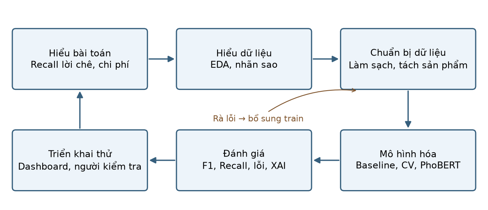{#fig-crispdm width=100%}

| Giai đoạn | Việc trong đồ án | Notebook |
|---|---|---|
| Business Understanding | Persona, SMART, ROI | 09 |
| Data Understanding | EDA 3 nguồn dữ liệu | 01, 05 |
| Data Preparation | Làm sạch, chia theo sản phẩm, tiền xử lý, đặc trưng mới, tập vàng | 02, 03, 05 |
| Modeling | Baseline, TF-IDF + LR/SVC, Word2Vec, PhoBERT, tinh chỉnh | 04, 06, 07, 08 |
| Evaluation | F1, ROC/PR-AUC, chi phí, SHAP, fairness | 09 |
| Deployment | ABSA, dashboard Streamlit | 10, app |

: Ánh xạ CRISP-DM vào đồ án [@wirth2000crispdm] {#tbl-crispdm}

Quy trình có vòng phản hồi: lỗi nhãn ở giai đoạn đánh giá dẫn trở lại chuẩn bị dữ liệu; lỗi khía cạnh dẫn tới rà từ điển trên train. Trong Design Thinking, persona hỗ trợ Empathize/Define; so sánh đọc tay, lọc sao và mô hình là Ideate; dashboard là Prototype. Test với người dùng thật chưa có phản hồi, nên mới hoàn thành thiết kế và thử nghiệm kỹ thuật.

## Các thuật toán sử dụng

**Bag-of-Words và Naive Bayes.** Văn bản được biểu diễn bằng tần suất từ/cụm từ. Multinomial Naive Bayes kết hợp các tần suất theo giả định độc lập có điều kiện để ước lượng lớp. Mô hình làm baseline vì đơn giản, huấn luyện nhanh và giúp kiểm tra phương pháp phức tạp có tạo thêm giá trị hay không.

**TF-IDF và Logistic Regression/LinearSVC.** TF-IDF giảm trọng số của từ phổ biến, tăng vai trò của từ phân biệt văn bản. LR học điểm số tuyến tính rồi chuyển thành xác suất các lớp; LinearSVC tìm biên phân tách và không cung cấp trực tiếp xác suất đã hiệu chỉnh. Unigram/bigram giữ một phần ngữ cảnh ngắn như cụm phủ định. Các mô hình phù hợp dữ liệu có nhãn còn ít và chạy trên CPU [@pedregosa2011sklearn].

**Word2Vec.** Vector từ được học qua ngữ cảnh đồng xuất hiện. Đồ án dùng skip-gram, lấy trung bình vector từ thành vector review rồi phân loại bằng LR. Vector học trên văn bản train A+B+Aug; bộ phân loại dùng nhãn A+B. Biểu diễn liên tục giúp khảo sát quan hệ ngữ nghĩa nhưng lấy trung bình làm mất thứ tự và có thể làm mờ phạm vi phủ định [@mikolov2013word2vec].

**PhoBERT.** Mô hình ngôn ngữ tiền huấn luyện cho tiếng Việt cung cấp biểu diễn phụ thuộc ngữ cảnh [@nguyen2020phobert]. Đồ án fine-tune phân loại ba lớp trên A+B, chọn learning rate/checkpoint bằng ViSD4SA dev. Cách tiếp cận khai thác ngữ cảnh rộng hơn TF-IDF, đổi lại cần tài nguyên huấn luyện và triển khai lớn hơn.

**ABSA kết hợp từ điển và mô hình.** ABSA tách nhận diện khía cạnh khỏi cảm xúc gắn với khía cạnh [@pontiki2014semeval]. Đồ án dùng từ khóa phát hiện bốn khía cạnh trong từng mệnh đề, kết hợp TF-IDF+LR với luật lời chê và phủ định; tổng hợp nhãn nhiều mệnh đề, ưu tiên tiêu cực khi hòa. Đây là heuristic của đồ án, không phải mô hình có giám sát huấn luyện theo bài báo tham khảo.

**Giải thích tuyến tính theo SHAP.** SHAP quy đóng góp đặc trưng vào đầu ra mô hình [@lundberg2017shap]. Với LR, notebook tính hệ số nhân chênh lệch TF-IDF so với trung bình train. Đóng góp cộng giá trị nền tái tạo logit, không phải phần trăm xác suất. Cách diễn giải giả định các đặc trưng độc lập; tương quan từ/bigram vẫn là hạn chế.

# Khám phá và tiền xử lý dữ liệu

## Nguồn dữ liệu và từ điển dữ liệu

| Nguồn                       |   Số quan sát | Miền                      | Nhãn                    |
|:----------------------------|--------------:|:--------------------------|:------------------------|
| A: ViSD4SA (train/dev/test) |         10510 | Điện thoại                | Cụm từ → câu            |
| B: Shopee (sau làm sạch)    |          2548 | 32 sản phẩm, 9 ngành hàng | Sao (yếu) + 300 câu tay |
| Aug: không dấu (đã lọc)     |          1205 | Mỹ phẩm, đa ngành         | 2 lớp                   |

: Ba nguồn dữ liệu và vai trò {#tbl-sources}

ViSD4SA là review điện thoại có nhãn cảm xúc theo cụm/khía cạnh [@phan2021visd4sa]. Notebook 02 chuyển nhãn về cấp câu theo quy tắc đã cài đặt và giữ split train/dev/test của nguồn sau làm sạch; tổng còn 10.510 câu. Kết quả phân loại câu của đồ án không so trực tiếp với điểm ABSA nguyên bản.

Shopee là tệp CSV có sẵn trong dự án, ban đầu gồm 2.843 review của 32 sản phẩm; không coi việc đọc tệp là minh chứng tự thu thập bằng crawler. Sau làm sạch còn 2.548 review. Dữ liệu có văn bản, sản phẩm và sao; ngành hàng gán theo từ khóa tên sản phẩm. Aug có 1.205 câu sau lọc, chỉ có hai lớp và chưa xác minh đầy đủ nguồn gốc, nên chỉ dùng trong thí nghiệm train, không làm tập kiểm định.

Tên `gold_500.csv` phản ánh kế hoạch ban đầu; hiện có 300 câu gán cảm xúc, trong đó 200 câu đủ nhãn bốn khía cạnh (notebook 03). Không lấy số 500 trong tên file làm cỡ mẫu đánh giá.

| Nguồn    | Biến                        | Kiểu                                      | Mô tả                                            | Ý nghĩa kinh doanh                             |
|---------|---------------|--------------------|----------------------------|----------------------------|
| Shopee   | id                          | chuỗi                                     | Mã review do nhóm tạo (shp_XXXX)                 | Truy vết review, ẩn danh người mua             |
| Shopee   | product                     | chuỗi                                     | Tên sản phẩm (32 sản phẩm)                       | Đơn vị để so sánh chất lượng giữa các mặt hàng |
| Shopee   | category                    | chuỗi                                     | Ngành hàng, nhóm tự gán (9 ngành)                | So sánh mức hài lòng giữa ngành hàng           |
| Shopee   | rating                      | số nguyên 1–5                             | Số sao người mua chấm                            | Mức hài lòng tổng quát; là nhãn yếu            |
| Shopee   | text                        | chuỗi                                     | Nội dung review gốc                              | Nguồn insight về lý do hài lòng/không hài lòng |
| Shopee   | text_clean                  | chuỗi                                     | Review đã bỏ nhãn mục template, gộp khoảng trắng | Đầu vào cho phân tích                          |
| Shopee   | weak_label                  | pos/neu/neg                               | Nhãn suy từ sao: 1–2 neg, 3 neu, 4–5 pos         | Nhãn huấn luyện rẻ nhưng nhiễu                 |
| ViSD4SA  | text                        | chuỗi                                     | Review điện thoại                                | Dữ liệu huấn luyện có nhãn chuẩn               |
| ViSD4SA  | labels                      | danh sách [start, end, KHÍA_CẠNH#CẢM_XÚC] | Nhãn theo cụm từ, 10 khía cạnh                   | Cho biết khách khen/chê phần nào               |
| ViSD4SA  | label                       | pos/neu/neg                               | Nhãn cả câu, nhóm tự gộp từ nhãn cụm             | Mục tiêu phân loại                             |
| ViSD4SA  | chat_luong, gia_ca, dich_vu | pos/neu/neg/trống                         | Cảm xúc theo 3 nhóm khía cạnh                    | Huấn luyện ABSA                                |
| Aug      | text                        | chuỗi                                     | Review không dấu                                 | Mô phỏng người dùng gõ không dấu               |
| Aug      | rating, label               | 1–5, positive/negative                    | Sao và nhãn 2 lớp                                | Chỉ dùng để huấn luyện                         |
| Tập vàng | sentiment                   | pos/neu/neg                               | Nhãn tay theo labeling/guideline.md              | Thước đo chất lượng mô hình thật               |
| Tập vàng | giao_hang … dich_vu         | pos/neu/neg/none                          | Nhãn tay theo 4 khía cạnh                        | Đánh giá ABSA                                  |

: Từ điển dữ liệu {#tbl-dict}

## Phân tích khám phá và phát hiện kinh doanh

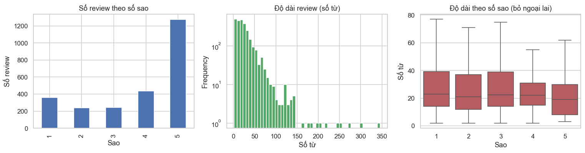{#fig-target width=100%}

Phân phối sao lệch trái với skewness −0,86, tập trung về phía nhiều sao. Độ dài review lệch phải mạnh (4,12); sau log1p, skewness còn −0,03. Trung vị độ dài ở 1 sao là 23 từ, trong khi 5 sao là 19 từ (notebook 05). Điểm sao cao không có nghĩa không có phản ánh cần xử lý. Review dài có thể chứa nhiều thông tin nên không loại chỉ vì dài; log độ dài giúp giảm ảnh hưởng của văn bản quá dài khi tạo đặc trưng, không phải quy tắc xác định cảm xúc.

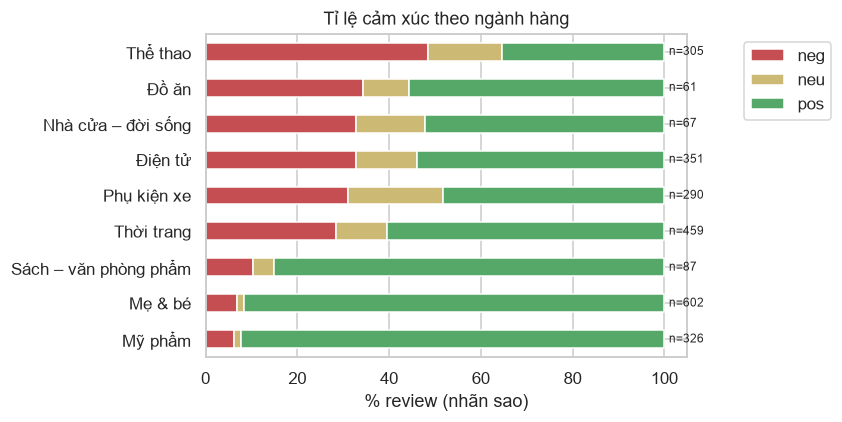{#fig-category width=85%}

Thể thao có tỷ lệ nhãn sao tiêu cực cao nhất trong mẫu (48,5%), tiếp đến Đồ ăn (34,4%); Mỹ phẩm và Mẹ & bé thấp hơn (6,1% và 6,8%). Đây là nhãn suy từ sao, khác cảm xúc do người hoặc mô hình xác định từ văn bản. Chênh lệch gợi ý ưu tiên đọc lại nhóm có nhiều phản ánh, nhưng không đủ để kết luận chất lượng cả ngành: cơ cấu sản phẩm và cỡ mẫu không đồng đều, một số ngành chỉ có một sản phẩm.

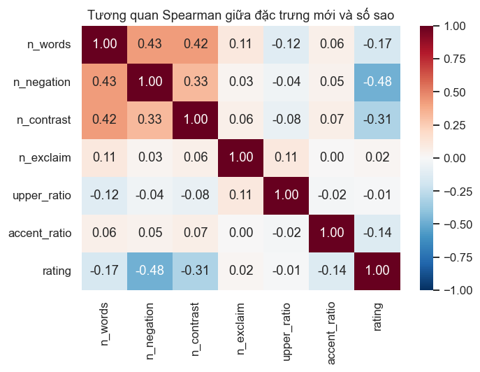{#fig-corr width=65%}

Số từ phủ định tương quan âm mạnh nhất với sao (Spearman −0,478), tiếp theo là từ đối lập như “nhưng” (−0,312). Độ dài tương quan âm yếu hơn (−0,166); tỷ lệ chữ hoa (−0,009) và dấu chấm than (0,020) gần như không có quan hệ đơn điệu. Kết quả ủng hộ giữ tín hiệu phủ định và cấu trúc khen–chê, nhưng tương quan không chứng minh nguyên nhân hay bảo đảm tăng điểm mô hình. Đặc trưng chỉ tính từ văn bản; sao dùng đối chiếu EDA, không làm đầu vào dự đoán.

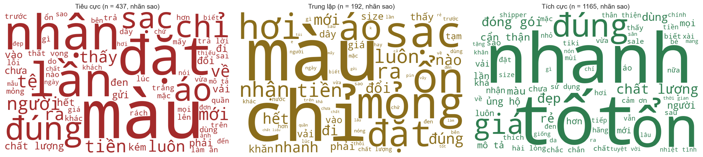{#fig-wc width=100%}

Word cloud dùng Shopee train với nhãn sao ban đầu, mô tả cách dùng từ trước gán lại; không phải word cloud của tập vàng hoặc PhoBERT. Kích thước từ thể hiện tần suất sau bỏ từ chung, không phải độ nghiêm trọng khiếu nại. Một từ có thể xuất hiện ở cả lời khen lẫn chê nên cần đọc lại ngữ cảnh. Việc bỏ từ chung, kể cả phủ định, khỏi riêng word cloud không đồng nghĩa bỏ khỏi đầu vào mô hình.

| rating   |   neg |   neu |   pos |   All |
|:---------|------:|------:|------:|------:|
| 1        |    58 |     1 |     0 |    59 |
| 2        |    33 |     4 |     1 |    38 |
| 3        |    23 |     6 |     2 |    31 |
| 4        |     3 |    15 |    42 |    60 |
| 5        |     4 |     5 |   103 |   112 |
| All      |   121 |    31 |   148 |   300 |

: Nhãn tay theo số sao trên 300 câu vàng (notebook 03) {#tbl-star-label}

Trong 31 review 3 sao ở @tbl-star-label, chỉ 6 câu gán trung lập, trong khi 23 câu tiêu cực. Một số review 4–5 sao cũng là lời chê. Điều này giải thích vì sao không đánh đồng số sao với cảm xúc. Do mẫu lấy dư review ít sao, không suy ra tỷ lệ khiếu nại của toàn sàn.

## Chuẩn bị dữ liệu

| nguồn   | bước                                   |   số dòng |
|:--------|:---------------------------------------|----------:|
| Shopee  | file gốc                               |      2843 |
| Shopee  | bỏ rác giao diện 'Tổng quan…'          |      2723 |
| Shopee  | khử trùng (sau khi bỏ nhãn mục)        |      2556 |
| Shopee  | bỏ review < 2 từ                       |      2548 |
| Aug     | file gốc                               |      1347 |
| Aug     | khử trùng                              |      1347 |
| Aug     | bỏ review < 2 từ                       |      1347 |
| Aug     | giữ câu có sao và nhãn khớp (bỏ 3 sao) |      1205 |
| A-train | file gốc                               |      7785 |
| A-train | bỏ review không có cụm nào             |      7625 |
| A-train | bỏ review hòa cảm xúc                  |      7347 |
| A-dev   | file gốc                               |      1112 |
| A-dev   | bỏ review không có cụm nào             |      1086 |
| A-dev   | bỏ review hòa cảm xúc                  |      1046 |
| A-test  | file gốc                               |      2225 |
| A-test  | bỏ review không có cụm nào             |      2186 |
| A-test  | bỏ review hòa cảm xúc                  |      2120 |
| A-train | bỏ câu trùng với dev/test              |      7344 |
| Shopee  | train sau khi bỏ trùng với kho vàng    |      1794 |
| Aug     | sau khi bỏ trùng với kho vàng          |      1205 |
| A-train | sau khi bỏ trùng với kho vàng          |      7344 |

: Số dòng sau từng bước làm sạch dữ liệu Shopee {#tbl-cleaning}

| Biến thể                         |   Số từ vựng |   F1_ViSD_test |   F1_gold |
|:---------------------------------|-------------:|---------------:|----------:|
| (1) Thô                          |       102231 |          0.713 |     0.608 |
| (2) Chuẩn hóa                    |        97965 |          0.713 |     0.637 |
| (3) + Tách từ                    |       110479 |          0.717 |     0.619 |
| (4) + Bỏ stopword (giữ phủ định) |       104329 |          0.726 |     0.588 |

: Ảnh hưởng của các bước tiền xử lý (TF-IDF + LR, train A+B, F1-macro) {#tbl-preprocess}

Notebook 02 loại rác giao diện “Tổng quan/Trợ lý AI tổng hợp”, bỏ nhãn mục template, chuẩn hóa, khử trùng và loại review quá ngắn theo quy tắc định trước. Shopee giảm từ 2.843 xuống 2.548 dòng. Sau chia theo sản phẩm, 22 sản phẩm vào train và 10 vào kho vàng; bỏ thêm 8 văn bản train trùng kho vàng nên train ban đầu còn 1.794 câu. Review dài không bị loại chỉ vì là ngoại lai; nội dung rác cần xem xét theo ngữ nghĩa. PhoBERT có giới hạn độ dài đầu vào nên có thể mất ý ở cuối review dài.

Chia Shopee theo sản phẩm tránh review cùng mặt hàng vào cả train và tập đánh giá. ViSD4SA giữ split nguồn do không có khóa sản phẩm đầy đủ như Shopee; không tuyên bố chia theo sản phẩm cho nguồn này. Học từ vựng, IDF và chuẩn hóa đặc trưng nằm trong pipeline CV, chỉ fit trên train của fold. Aug chỉ ghép vào train. Lọc trùng văn bản không chứng minh loại mọi bản diễn đạt gần nghĩa.

Đặc trưng mới gồm độ dài log, số từ phủ định, số từ đối lập, dấu chấm than, tỷ lệ chữ hoa và tỷ lệ ký tự có dấu. Hiệu quả phải kiểm tra bằng CV, không suy từ tương quan. Tiền xử lý chuẩn hóa Unicode, teencode, ký tự lặp, đổi emoji thành token và tách từ; từ phủ định được giữ ở biến thể bỏ stopword.

Theo @tbl-preprocess, F1-macro ViSD4SA test lần lượt là 0,713 (thô), 0,713 (chuẩn hóa), 0,717 (thêm tách từ) và 0,726 (thêm bỏ stopword). Trên vàng Shopee: 0,608; 0,637; 0,619; 0,588. Ablation này dùng cấu hình riêng của notebook 07, không phải kết quả sau tuning notebook 06. Tiền xử lý không giúp đồng đều giữa hai miền; không dùng điểm vàng/test để chọn lại pipeline. Tập vàng chỉ một người gán nên còn hạn chế về độ tin cậy.

### Gán lại nhãn cho review 3–4 sao

Nhãn train Shopee ban đầu suy từ số sao (1–2 sao là tiêu cực, 3 sao là trung lập, 4–5 sao là tích cực). Nhóm gán lại 250 review: toàn bộ 192 review 3 sao và 58 review 4 sao chọn ngẫu nhiên. Claude đề xuất nhãn theo `labeling/guideline.md` mà không xem số sao, nhóm duyệt và sửa 50 nhãn, bỏ 6 câu rác. Kết quả có 178 nhãn khác nhãn theo sao; phân bố Shopee train đổi từ 1.165/437/192 (tích cực/tiêu cực/trung lập) thành 1.153/591/44. Trong bảng so sánh gán lại nhãn, tham số mô hình cổ điển giữ nguyên; kết quả chính ở phần sau đã tinh chỉnh lại bằng notebook 06. PhoBERT chạy lại quy trình chọn learning rate trên ViSD4SA dev, nhưng learning rate được chọn khác nhau giữa hai phiên bản. Các kết quả ở những phần sau dùng nhãn gán lại. Tập vàng đã được xem trước thí nghiệm này, nên số trên tập vàng chỉ có giá trị thăm dò.

| Mô hình            | Nhãn train   |   F1-macro – Vàng Shopee (thăm dò) |   F1-macro – ViSD4SA test |   Recall neg – Vàng Shopee (thăm dò) |   Recall neg – ViSD4SA test |
|:-------------------|:-------------|-----------------------------------:|--------------------------:|-------------------------------------:|----------------------------:|
| BoW+NB             | Nhãn sao     |                              0.568 |                     0.595 |                                0.744 |                       0.902 |
| BoW+NB             | Nhãn gán lại |                              0.583 |                     0.585 |                                0.810 |                       0.901 |
| TF-IDF+LR          | Nhãn sao     |                              0.601 |                     0.713 |                                0.694 |                       0.918 |
| TF-IDF+LR          | Nhãn gán lại |                              0.619 |                     0.717 |                                0.826 |                       0.923 |
| TF-IDF+LinearSVC   | Nhãn sao     |                              0.607 |                     0.708 |                                0.719 |                       0.921 |
| TF-IDF+LinearSVC   | Nhãn gán lại |                              0.598 |                     0.705 |                                0.802 |                       0.920 |
| TF-IDF+features+LR | Nhãn sao     |                              0.607 |                     0.707 |                                0.694 |                       0.917 |
| TF-IDF+features+LR | Nhãn gán lại |                              0.603 |                     0.707 |                                0.810 |                       0.914 |
| PhoBERT            | Nhãn sao     |                              0.617 |                     0.808 |                                0.595 |                       0.914 |
| PhoBERT            | Nhãn gán lại |                              0.704 |                     0.779 |                                0.851 |                       0.923 |

: So sánh nhãn theo sao và nhãn gán lại (train A+B) {#tbl-relabel}

Review 3 sao có thể là lời chê rõ hoặc ý kiến pha trộn, nên gán mặc định trung lập tạo nhiễu. Gán theo nội dung phù hợp mục tiêu phát hiện phản ánh hơn, nhưng Shopee train sau gán lại chỉ còn 44 câu trung lập; cần bổ sung dữ liệu thật cho lớp này.

Trong @tbl-relabel, PhoBERT đổi Recall tiêu cực ViSD4SA test từ 0,914 lên 0,923, nhưng F1-macro giảm từ 0,808 xuống 0,779. Trên vàng Shopee đã xem, Recall tiêu cực tăng từ 0,595 lên 0,851, F1-macro từ 0,617 lên 0,704; chỉ mang tính thăm dò. Người thực hiện chọn nhãn gán lại để phản ánh nội dung và ưu tiên lời chê, không coi điểm tăng trên vàng là kiểm định độc lập.

Hai lần PhoBERT chọn learning rate khác nhau nên không quy toàn bộ chênh lệch cho nhãn. Cấu hình Colab chưa ghi dấu vết tệp train đủ để xác minh nguồn huấn luyện. Ghi chú nhãn dòng stt 108 được script diễn giải thành tiêu cực, cần người gán xác nhận. Bản thảo ghi rõ các giới hạn, không tự sửa nhãn hoặc huấn luyện lại để làm đẹp điểm.

# Thiết kế, huấn luyện và tối ưu mô hình

## Mô hình cơ sở và kiểm định chéo theo sản phẩm

| model               | best_params                                   |   cv_f1_mean |   cv_f1_std |
|:--------------------|:----------------------------------------------|-------------:|------------:|
| BoW+NB (baseline)   | mặc định                                      |        0.601 |       0.017 |
| TF-IDF+LR           | {'C': 10, 'min_df': 2, 'ngram_range': (1, 2)} |        0.665 |       0.046 |
| TF-IDF+LinearSVC    | {'C': 1, 'min_df': 2, 'ngram_range': (1, 2)}  |        0.658 |       0.061 |
| TF-IDF+đặc trưng+LR | C=3                                           |        0.631 |       0.045 |

: Kết quả GroupKFold 5 fold theo sản phẩm trên Shopee train (F1-macro) {#tbl-cv}

BoW+NB đạt F1-macro CV 0,601 ± 0,017 trên Shopee train; TF-IDF+LR đạt 0,665 ± 0,046, LinearSVC 0,658 ± 0,061. Các mô hình dùng cùng GroupKFold theo sản phẩm, phù hợp nhu cầu xử lý mặt hàng chưa có trong train hơn chia ngẫu nhiên từng review. Vectorizer được fit bên trong pipeline mỗi fold.

Cùng cấu hình LR, StratifiedKFold xáo ngẫu nhiên cho 0,673 ± 0,041, so với GroupKFold 0,665 ± 0,046 (notebook 06). Chênh lệch nhỏ và độ lệch chuẩn chồng lấn, không định lượng chắc chắn mức rò rỉ. Chọn chia theo sản phẩm vì phù hợp thiết kế đánh giá, không phải vì chia ngẫu nhiên luôn tăng điểm nhiều. CV đồng thời dùng chọn tham số nên điểm CV tối ưu chưa phải ước lượng độc lập sau chọn mô hình.

## Tinh chỉnh siêu tham số và chống quá khớp

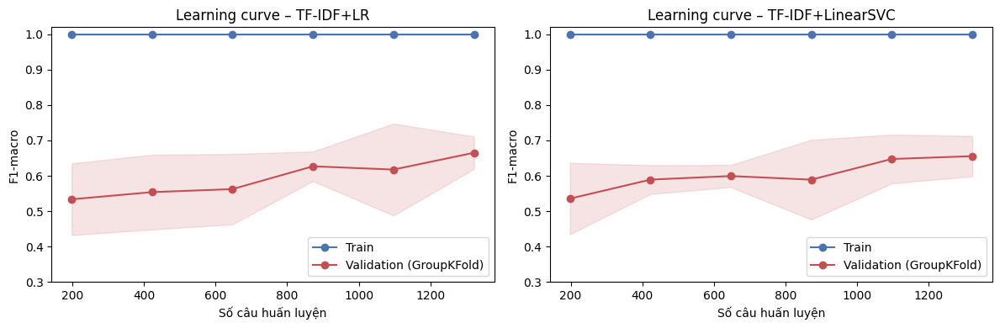{#fig-lc width=100%}

GridSearchCV khảo sát C, min_df và unigram/bigram. LR được chọn C=10, min_df=2, n-gram (1,2); LinearSVC chọn C=1 cùng cấu hình từ vựng. Class weight balanced hỗ trợ lớp ít mẫu; C điều khiển điều chuẩn, min_df hạn chế từ hiếm. Thêm đặc trưng nghiệp vụ cho F1-macro CV 0,631, thấp hơn LR thuần 0,665, nên chưa chứng minh cải thiện dù tương quan EDA có ý nghĩa.

Learning curve có F1 train 1,000 nhưng validation thấp hơn nhiều. Với LR, validation tăng từ 0,534 lên 0,665 khi mẫu train tăng từ 198 lên 1.322; SVC từ 0,536 lên 0,656. Khoảng cách tổng quát hóa còn lớn. Thêm dữ liệu đa dạng là hướng cần thử, không bảo đảm tiếp tục tăng điểm. Điều chuẩn và CV theo sản phẩm giúp giảm rủi ro đánh giá lạc quan, không chứng minh đã hết quá khớp.

PhoBERT thử learning rate 2e-5 và 3e-5, chọn theo F1-macro ViSD4SA dev; không chạy CV năm fold do chi phí GPU. Đây là hạn chế khi so sánh phương sai với mô hình cổ điển. Log hiện có cho thấy train loss giảm còn dev loss tăng ở epoch cuối; chọn checkpoint theo F1 không đồng nghĩa loss không quá khớp. Cần giữ rõ tiêu chí chọn checkpoint và giới hạn này khi tái lập.

## So sánh các mô hình và nguồn huấn luyện

| model               |   A+B |   A+B+Aug |     B |
|:--------------------|------:|----------:|------:|
| BoW+NB (baseline)   | 0.583 |     0.558 | 0.607 |
| TF-IDF+LR           | 0.605 |     0.603 | 0.608 |
| TF-IDF+LinearSVC    | 0.601 |     0.600 | 0.605 |
| TF-IDF+đặc trưng+LR | 0.646 |     0.646 | 0.590 |

: F1-macro trên tập vàng Shopee theo nguồn train (thăm dò) {#tbl-tuned}

|      C |   F1_A_dev |   F1_ViSD_test |   F1_gold |
|-------:|-----------:|---------------:|----------:|
|  0.100 |      0.633 |          0.630 |     0.624 |
|  1.000 |      0.629 |          0.625 |     0.621 |
| 10.000 |      0.628 |          0.625 |     0.621 |

: Word2Vec: vector học trên A+B+Aug, LR train A+B {#tbl-w2v}

Trên ViSD4SA test, thêm A vào B làm F1-macro TF-IDF+LR tăng từ 0,510 lên 0,724; trên vàng Shopee gần như không tăng (0,608 và 0,605). Đây là khác biệt miền/phân bố nhãn, không chứng minh thêm dữ liệu luôn tốt. Kết quả Aug chỉ là ablation, không dùng thay mô hình chính theo điểm vàng.

Word2Vec+LR chọn C=0,1 theo ViSD4SA dev (F1-macro 0,633), đạt 0,630 trên ViSD4SA test và 0,624 trên vàng Shopee (thăm dò). Trên test ViSD4SA, kết quả thấp hơn TF-IDF+LR; lấy trung bình vector có thể mất trật tự/phủ định nhưng thí nghiệm chưa tách riêng nguyên nhân. Không dùng điểm vàng chọn C.

# Đánh giá chuyên sâu, giải thích mô hình và đạo đức AI

## Chỉ số kỹ thuật

|                   |   BoW+NB (baseline) |   TF-IDF+LR |   TF-IDF+LinearSVC |   TF-IDF+đặc trưng+LR |   PhoBERT |
|:------------------|--------------------:|------------:|-------------------:|----------------------:|----------:|
| Accuracy          |               0.803 |       0.810 |              0.803 |                 0.823 |     0.837 |
| Precision (macro) |               0.875 |       0.766 |              0.763 |                 0.775 |     0.726 |
| Recall (macro)    |               0.601 |       0.615 |              0.609 |                 0.642 |     0.694 |
| F1-macro          |               0.583 |       0.605 |              0.601 |                 0.646 |     0.704 |
| Recall neg        |               0.810 |       0.826 |              0.810 |                 0.851 |     0.851 |
| ROC-AUC (OvR)     |               0.836 |       0.863 |              0.860 |                 0.861 |     0.902 |
| PR-AUC (macro)    |               0.670 |       0.710 |              0.702 |                 0.714 |     0.761 |
| F1 ViSD test      |               0.585 |       0.724 |              0.699 |                 0.719 |     0.779 |

: Kết quả vàng Shopee (thăm dò); dòng cuối là F1-macro ViSD4SA test {#tbl-main}

| Mô hình             |   F1-macro |   CI 2.5% |   CI 97.5% |
|:--------------------|-----------:|----------:|-----------:|
| BoW+NB (baseline)   |      0.583 |     0.537 |      0.633 |
| TF-IDF+LR           |      0.605 |     0.555 |      0.670 |
| TF-IDF+LinearSVC    |      0.601 |     0.546 |      0.661 |
| TF-IDF+đặc trưng+LR |      0.646 |     0.580 |      0.710 |
| PhoBERT             |      0.704 |     0.640 |      0.767 |

: Khoảng bootstrap 95% F1-macro trên vàng Shopee (thăm dò) {#tbl-ci}

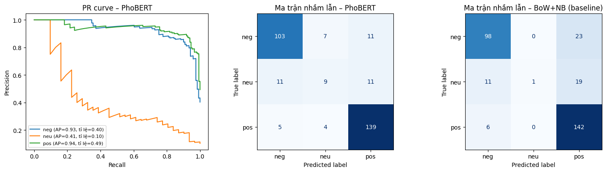{#fig-eval width=100%}

Recall tiêu cực là chỉ số nghiệp vụ chính vì đo khả năng tìm lời chê; F1-macro luôn đi kèm để tránh tăng Recall bằng cách dự đoán quá nhiều câu tiêu cực hoặc bỏ qua trung lập. Accuracy bị chi phối bởi lớp phổ biến. PR-AUC mô tả đánh đổi Precision–Recall theo ngưỡng; ROC-AUC OvR và các chỉ số macro bổ sung góc nhìn phân biệt ba lớp.

Trên vàng Shopee, PhoBERT có Recall tiêu cực 0,851, F1-macro 0,704, Accuracy 0,837. TF-IDF+LR dùng trong dashboard có Recall tiêu cực 0,826, F1-macro 0,605; không gán điểm PhoBERT cho app chạy LR. Trên ViSD4SA test, PhoBERT đạt F1-macro 0,779, LR đạt 0,724. Mục tiêu 0,75 chỉ đạt ở PhoBERT trên ViSD4SA test.

Xét tiêu cực là lớp cảnh báo: dương tính giả là review không tiêu cực bị đưa cho nhân viên đọc; âm tính giả là lời chê bị bỏ qua. Theo giả định chi phí, dương tính giả phát sinh công đọc, âm tính giả có thể mất cơ hội giữ khách. Recall cao có ý nghĩa nghiệp vụ nhưng cần kiểm soát Precision và số review phải đọc để tránh quá tải.

Khoảng bootstrap của PhoBERT [0,640; 0,767] phản ánh biến động lấy lại mẫu trên dữ liệu đang có. Notebook 09 lấy mẫu theo câu, chưa phản ánh đầy đủ phụ thuộc cùng sản phẩm; khoảng này không khắc phục việc đã xem vàng và không chứng minh vượt 0,75. Chọn mô hình để vẽ ma trận nhầm lẫn, tính chi phí, HITL hiện dựa bảng điểm vàng, nên các phân tích tiếp theo là hậu kiểm thăm dò, không phải quy trình chọn mô hình triển khai.

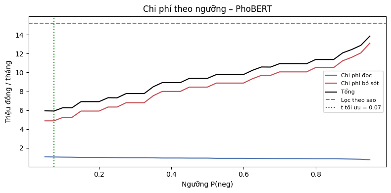{#fig-cost width=75%}

@fig-cost minh họa giảm ngưỡng làm tăng lượng cần đọc nhưng có thể giảm bỏ sót. Đường chi phí và điểm thấp nhất tính trên vàng đã xem; không dùng điểm này làm ngưỡng triển khai được kiểm định. Ngưỡng vận hành cần chọn trên tập phát triển riêng theo năng lực CSKH, rồi đánh giá trên tập khóa độc lập.

## Giải thích mô hình

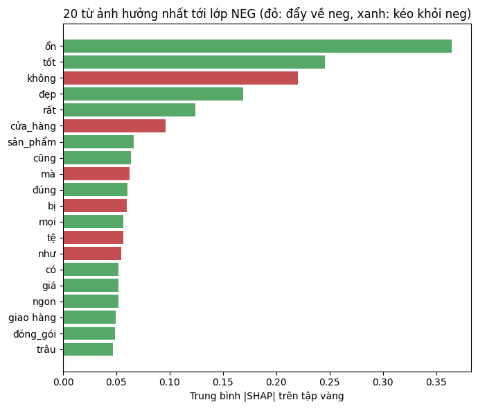{#fig-shap-global width=70%}

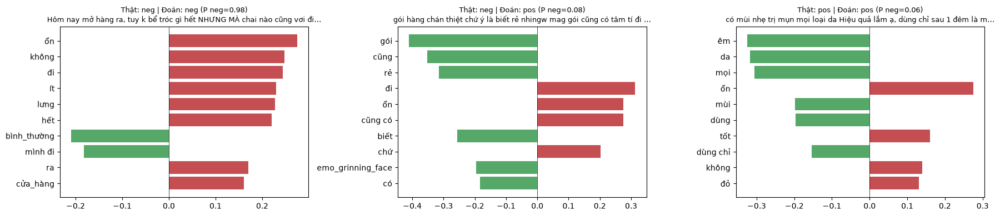{#fig-shap-local width=100%}

Trong @fig-shap-local, TF-IDF+LR nhận đúng câu tiêu cực ở ví dụ đầu, nhưng bỏ sót câu chê đóng gói ở ví dụ thứ hai; xác suất tiêu cực của câu thứ hai chỉ khoảng 0,08. Các từ như “cũng” và “rẻ” kéo logit tiêu cực xuống, cho thấy mô hình có thể dựa quá nhiều vào tín hiệu từ riêng lẻ. Ví dụ thứ ba là câu tích cực có từ phủ định, nhắc rằng cần đọc phạm vi phủ định. Các ví dụ này minh họa cơ chế LR trên tập vàng đã xem, không đại diện tần suất lỗi.

Ở @fig-shap-global, “không”, “tệ”, “bị” có hệ số hướng về tiêu cực; “ổn”, “tốt”, “đẹp” hướng ngược lại. Điều này phù hợp tín hiệu thường gặp nhưng có ngoại lệ như “không tệ”. Hình tổng thể dùng trung bình trị tuyệt đối đóng góp, còn màu theo hệ số; màu không mô tả dấu đóng góp của mọi câu.

Giải thích từng câu cần so với nền trung bình train: từ không xuất hiện vẫn có đóng góp khác không vì TF-IDF thấp hơn nền. Cột đỏ mang tên từ khen không có nghĩa từ ấy luôn làm câu tiêu cực. SHAP giải thích cách LR dùng đặc trưng, không xác nhận lời khách nói hoặc chứng minh nhân quả. Từ chỉ sản phẩm có thể thành lối tắt nếu đi cùng một nhãn trong train; chia theo sản phẩm và xem lỗi sản phẩm mới giúp nhận diện rủi ro.

Dashboard dùng tích hệ số với TF-IDF để phản hồi nhanh, chưa trừ nền trung bình như notebook; cần gọi là đóng góp tuyến tính. Nhân viên nên xem đóng góp cùng review gốc, khía cạnh và mức chắc chắn thay vì dựa riêng một từ.

## Đạo đức AI và rủi ro vận hành

| category              |      n |   % neg thật |   F1-macro |   Recall neg |
|:----------------------|-------:|-------------:|-----------:|-------------:|
| Phụ kiện xe           | 33.000 |       60.606 |      0.588 |        0.850 |
| Mẹ & bé               | 31.000 |       32.258 |      0.609 |        0.900 |
| Thời trang            | 99.000 |       41.414 |      0.655 |        0.829 |
| Mỹ phẩm               | 80.000 |       28.750 |      0.739 |        0.826 |
| Đồ ăn                 | 25.000 |       52.000 |      0.753 |        0.769 |
| Điện tử               | 26.000 |       53.846 |      0.804 |        1.000 |
| Sách – văn phòng phẩm |  6.000 |        0.000 |      1.000 |        0.000 |

: Hiệu năng theo ngành hàng {#tbl-fair}

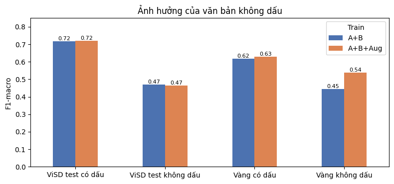{#fig-unaccent width=75%}

|     τ |   % chuyển người |   F1-macro phần tự động |   Recall neg phần tự động |
|------:|-----------------:|------------------------:|--------------------------:|
| 0.000 |            0.000 |                   0.704 |                     0.851 |
| 0.500 |            1.300 |                   0.700 |                     0.864 |
| 0.600 |            2.300 |                   0.707 |                     0.871 |
| 0.700 |            4.700 |                   0.702 |                     0.875 |
| 0.800 |            7.300 |                   0.722 |                     0.907 |

: Đánh đổi khi chuyển câu không chắc chắn cho nhân viên (Human-in-the-loop) {#tbl-hitl}

Trên vàng, PhoBERT có F1-macro 0,588 và Recall tiêu cực 0,850 ở Phụ kiện xe (33 câu), so với 0,804 và 1,000 ở Điện tử (26 câu). Cỡ mẫu nhỏ và cơ cấu nhãn khác nhau nên chưa chứng minh công bằng/bất công với nhóm người. Sách–văn phòng phẩm chỉ có 6 câu, không có nhãn tiêu cực: Recall ghi 0 theo quy ước zero_division, không phải bỏ sót toàn bộ lời chê. Ngành không có trong mẫu cũng chưa được đánh giá.

Ở thí nghiệm LR notebook 07, bỏ dấu làm F1-macro giảm từ 0,717 xuống 0,470 trên ViSD4SA test, từ 0,619 xuống 0,445 trên vàng. Aug nâng F1 vàng không dấu lên 0,537 nhưng không giúp ViSD4SA không dấu (0,465). Aug/vàng chỉ là thăm dò. Không gán tình trạng gõ không dấu cho tuổi, thiết bị hay nhóm xã hội vì dữ liệu không có các biến đó; cần văn bản không dấu có nguồn rõ và mẫu đánh giá độc lập.

Về quyền riêng tư, demo nên dùng văn bản đã loại tên, điện thoại, địa chỉ, thông tin giao dịch; không cần thêm định danh để phân loại. Tệp gốc/kết quả cần phân quyền, hạn chế lưu nội dung nhập và có quy trình xóa. Văn bản công khai vẫn có thể chứa thông tin cá nhân. Dữ liệu AI hỗ trợ tạo/gán cần ghi nguồn và người duyệt; Aug không thay nhãn thật, nhất là trung lập.

HITL chuyển câu có xác suất cao nhất dưới ngưỡng cho nhân viên. Mức minh họa 0,8 trong @tbl-hitl chuyển 7,3% câu; phần tự động có F1-macro 0,722, Recall tiêu cực 0,907. Đây là chỉ số trên phần giữ lại, không phải toàn hệ thống hoặc chất lượng xử lý của nhân viên. Chưa kiểm định hiệu chỉnh xác suất/ngưỡng độc lập. Câu tự tin cao vẫn có thể sai nên cần lấy mẫu kiểm tra cả nhóm này, ưu tiên phản ánh chất lượng/an toàn và nhiều khía cạnh trái chiều.

## Phân tích lỗi

Notebook 09 lấy ngẫu nhiên tối đa 40 dự đoán khác nhãn tay của PhoBERT. Codex đọc nội dung, đề xuất một nhóm chính mỗi câu; đây là diễn giải thăm dò cần người thực hiện duyệt, không phải nhãn lỗi đã đo đồng thuận. Nhãn cảm xúc và dự đoán được giữ nguyên. Một câu có thể có nhiều nguyên nhân; nhóm chính giúp sắp xếp việc rà soát.

| Nhóm lỗi                                  |   Số câu |   Tỉ lệ trong 40 câu (%) |
|:------------------------------------------|---------:|-------------------------:|
| Khen và chê ở nhiều khía cạnh/thời điểm   |       13 |                     32.5 |
| Nhãn tay cần rà soát                      |       11 |                     27.5 |
| Chưa trải nghiệm đủ hoặc chỉ nêu kỳ vọng  |        5 |                     12.5 |
| Teencode, chính tả và diễn đạt khó đọc    |        4 |                     10.0 |
| Câu ngắn, nhiễu template                  |        3 |                      7.5 |
| Nội dung nhiễu/ngoài trải nghiệm sản phẩm |        2 |                      5.0 |
| Phủ định không mang nghĩa chê             |        1 |                      2.5 |
| So sánh và lời chê hàm ý                  |        1 |                      2.5 |

: Phân nhóm 40 trường hợp khác nhãn tay (Codex đề xuất, thăm dò) {#tbl-errors}

Nhóm khen–chê nhiều khía cạnh/thời điểm có 13 câu. `shp_2329` khen giao hàng nhưng không vừa ý mùi nước hoa; một nhãn chung dễ làm mất lời chê cụ thể. Năm câu chưa trải nghiệm đủ/kỳ vọng, như `shp_0444` (“Trước mắt thấy ok Về lâu dài thì sử dụng mới biết”), cho thấy ranh giới trung lập và tích cực còn khó.

Có 11 câu cần rà nhãn tay, không tự kết luận mô hình đúng. `shp_2436` viết “quá tuyệt, thơm lâu.” nhưng nhãn tiêu cực; `shp_1446` viết “Sản phẩm ko lên pin” nhưng nhãn trung lập. Người gán cần đối chiếu hướng dẫn/ngữ cảnh gốc. Sửa nhãn rồi báo điểm tăng trên cùng tập đã xem là hậu kiểm, không phải cải thiện trên test độc lập.

Các nhóm còn lại: teencode/chính tả (4), câu ngắn có template (3), nhiễu/ngoài trải nghiệm (2), so sánh hàm ý (1), phủ định không phải lời chê (1). `shp_1048` chứa văn dài tả chim bồ câu; `shp_0473` so sánh thương hiệu khác thay vì chê trực tiếp. Cần kiểm tra nhiễu, thống nhất nhãn và thêm ví dụ train, rồi đánh giá trên tập mới. Tỷ lệ chỉ mô tả 40 bất đồng được chọn, không phải tỷ lệ lỗi của toàn bộ review.

## Kết quả phân tích theo khía cạnh

| Khía cạnh   |   Số câu có nhắc |   Precision phát hiện |   Recall phát hiện |   F1 phát hiện |   Acc cảm xúc (phát hiện đúng) |
|:------------|-----------------:|----------------------:|-------------------:|---------------:|-------------------------------:|
| Giao hàng   |               64 |                 0.688 |              0.859 |          0.764 |                          0.873 |
| Chất lượng  |              180 |                 0.958 |              0.633 |          0.763 |                          0.684 |
| Giá cả      |               30 |                 0.531 |              0.867 |          0.658 |                          0.885 |
| Dịch vụ     |               54 |                 0.519 |              0.741 |          0.611 |                          0.750 |

: ABSA trên 200 câu vàng có nhãn khía cạnh (thăm dò) {#tbl-absa-eval}

F1 phát hiện khía cạnh đạt 0,764 ở Giao hàng, 0,763 Chất lượng, 0,658 Giá cả và 0,611 Dịch vụ. Chất lượng có Precision 0,958 nhưng Recall 0,633, cho thấy bỏ sót nhiều cách diễn đạt; Dịch vụ có Precision 0,519, còn nhiều gắn nhầm. Độ chính xác cảm xúc chỉ tính khi phát hiện đúng khía cạnh, không phải toàn quy trình. Một câu nhắc nhiều khía cạnh nên tổng lượt nhắc vượt 200. Đây là đánh giá thăm dò trên vàng đã xem.

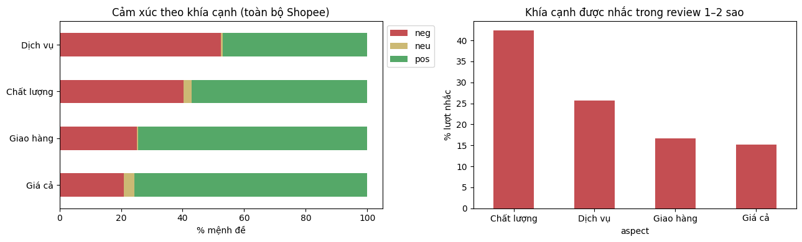{#fig-absa width=100%}

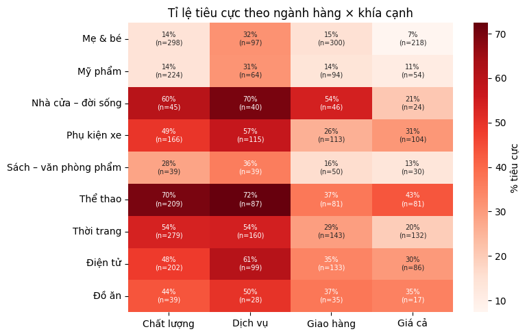{#fig-absa-heat width=80%}

Trên Shopee đã làm sạch, hệ thống phát hiện 1.501 lượt nhắc Chất lượng với tỷ lệ dự đoán tiêu cực 40,3%; Dịch vụ có 729 lượt, tỷ lệ 52,5% (`aspect_summary.csv`). Khía cạnh phổ biến và khía cạnh tỷ lệ chê cao phản ánh hai ưu tiên: lượng cần xử lý và mức tập trung vấn đề. Heatmap khoanh vùng để đọc lại; ô ít lượt nhắc không đủ ổn định để xếp hạng chắc chắn. Thống kê chứa cả review dùng train, là mô tả theo dự đoán, không phải tỷ lệ lỗi sản phẩm thật.

# Sản phẩm mẫu, khả năng ứng dụng và hướng phát triển

## Thiết kế ứng dụng mẫu

Ứng dụng Streamlit dùng TF-IDF+LR đã lưu cho cảm xúc và ABSA từ điển/luật cho khía cạnh. Văn bản qua cùng hàm tiền xử lý rồi hiển thị nhãn, mức chắc chắn, từ ảnh hưởng và khuyến nghị; không huấn luyện lại ở mỗi lần nhập.

| Tab | Tác vụ | Ý nghĩa |
|---|---|---|
| Phân tích review | Nhập review/tải CSV; xem và tải kết quả | CSKH đọc nhãn, khía cạnh, nội dung gốc và gợi ý xử lý. |
| What-if | Sửa câu, thử không dấu; thay giả định chi phí/ngưỡng | Giải thích hành vi và đánh đổi; kết quả vàng chỉ thăm dò. |
| Tổng quan Shopee | Lọc ngành, xem cảm xúc, khía cạnh, top từ khóa dự đoán tiêu cực | Chọn vấn đề để đọc lại, phân công xử lý. |

: Chức năng ứng dụng mẫu {#tbl-app}

Kịch bản demo bắt đầu với review vừa khen giao hàng vừa chê chất lượng: nhập nội dung, xem khía cạnh, đọc khuyến nghị và đối chiếu review gốc. Tiếp theo thử câu không dấu hoặc chưa dùng sản phẩm để minh họa giới hạn. Đổi trả/liên hệ khách chỉ là đề xuất, không tự động thực hiện.

PhoBERT chỉ dùng qua xác suất lưu sẵn trong phân tích ngoại tuyến/chi phí ghép; review mới chạy LR. Không lấy điểm PhoBERT mô tả chất lượng dự đoán trực tiếp của dashboard. Hồ sơ hiện chưa có ảnh ba tab hoặc link Web/video, cần bổ sung minh chứng thật trước nộp. Mô tả dựa mã nguồn không thay kiểm thử toàn giao diện.

## Ba vấn đề cần cải thiện

| category    | aspect     |   n_nhac |   n_che |   ti_le_che |
|:------------|:-----------|---------:|--------:|------------:|
| Thời trang  | Chất lượng |      279 |     150 |       0.538 |
| Thể thao    | Chất lượng |      209 |     146 |       0.699 |
| Điện tử     | Chất lượng |      202 |      97 |       0.480 |
| Thời trang  | Dịch vụ    |      160 |      87 |       0.544 |
| Phụ kiện xe | Chất lượng |      166 |      82 |       0.494 |
| Phụ kiện xe | Dịch vụ    |      115 |      66 |       0.574 |
| Thể thao    | Dịch vụ    |       87 |      63 |       0.724 |
| Điện tử     | Dịch vụ    |       99 |      60 |       0.606 |

: Các cặp ngành hàng × khía cạnh có nhiều lời chê nhất {#tbl-issues}

| Từ khóa   |   Số review chê |   Tỉ lệ chê |
|:----------|----------------:|------------:|
| không     |             501 |       0.555 |
| như       |             163 |       0.560 |
| quá       |             134 |       0.565 |
| chỉ       |             110 |       0.625 |
| đặt       |             105 |       0.583 |
| ra        |             104 |       0.654 |
| hết       |              82 |       0.726 |
| tiền      |              80 |       0.513 |
| về        |              77 |       0.535 |
| đi        |              77 |       0.631 |
| phải      |              72 |       0.550 |
| vào       |              67 |       0.615 |
| gì        |              66 |       0.545 |
| nào       |              66 |       0.680 |
| tệ        |              65 |       0.970 |

: Top từ khóa tiêu cực trên 2.548 review (nhãn dự đoán của TF-IDF+LR) {#tbl-keywords}

Ba ưu tiên chọn theo số lượt dự đoán chê trong `top_issue_candidates.csv`, sau đó đọc lại ví dụ. Mẫu số là review được nhận diện nhắc khía cạnh, không phải toàn review ngành. Trích đoạn từ `shopee_predicted.csv` giữ cách viết của khách; mã review để đối chiếu, không phải định danh. KPI là đề xuất, chưa phải kết quả đạt được.

### Chất lượng hàng thời trang

Có 150/279 lượt nhắc Chất lượng dự đoán tiêu cực (53,8%). Ví dụ: “đường may của balo bị lệch rất nhiều” (`shp_0985`); “Đã nhận, đường may bị méo, thất vọng” (`shp_0992`); “Chất lượng thì kém nịt vào kh hiểu sao nó bị kẹt cứng không tháo ra được” (`shp_0232`, trích đoạn).

Đề xuất phiếu kiểm theo loại hàng: đường may, khóa, màu/mẫu; ghi mã lô để truy nguyên. CSKH xin bằng chứng và chuyển kho xác minh trước đổi trả. **KPI đề xuất:** tỷ lệ phản ánh chất lượng xác nhận trên review nhắc chất lượng, thời gian phản hồi và tỷ lệ đổi trả do lỗi. Tháng thử nghiệm đầu thiết lập mốc nền bằng kiểm tra tay, sau đó chốt mức giảm mục tiêu. Không lấy 53,8% dự đoán làm tỷ lệ hàng lỗi thật.

### Độ bền và vật liệu sản phẩm thể thao

Có 146/209 lượt nhắc Chất lượng dự đoán tiêu cực (69,9%). Ví dụ: “quá tệ đá tý đã bung chỉ” (`shp_1719`); “Chất lượng quá tệ! Mới bơm lên đã bung chỉ may, sắp nổ! Không đáng tiền” (`shp_1727`); “Vải quá mỏng ko giống với ảnh” (`shp_1601`, trích đoạn).

Đề xuất kiểm tra độ bền đường may/vật liệu theo lô, bổ sung hình thật và mô tả độ dày/cách dùng. **KPI đề xuất:** tỷ lệ khiếu nại bung chỉ/rách xác nhận trên review nhắc chất lượng, tỷ lệ lô đạt kiểm tra, tỷ lệ đổi trả do độ bền. So sánh trước–sau cùng danh mục và cách gán nhãn; chưa kết luận hiệu quả khi cơ cấu hàng thay đổi.

### Chức năng sử dụng hàng điện tử

Có 97/202 lượt nhắc Chất lượng dự đoán tiêu cực (48,0%). Ví dụ: “sạc ko vào pin Sạc thử điện thoại 30p ko lên % nào” (`shp_1779`); “Hàng nhận được hư 2 cổng usb” (`shp_1791`); “Sản phẩm mới dùng sạc được 1 lần đã bị hỏng quá thất vọng” (`shp_0615`). Đây là phản ánh khách, chưa phải giám định kỹ thuật.

Đề xuất kiểm tra chức năng trước đóng gói, ghi lô phụ kiện và hướng dẫn tương thích; phản ánh hỏng/mất an toàn cần nhân viên ưu tiên. **KPI đề xuất:** tỷ lệ lỗi chức năng xác nhận, thời gian phản hồi đầu tiên và tỷ lệ hoàn tất đổi/bảo hành. Tách lỗi kỹ thuật khỏi giao nhầm/thiếu để tránh sai trách nhiệm.

Top từ khóa giúp tìm review nhưng không thay việc kiểm tra. Từ “không”, “như”, “quá” xuất hiện nhiều mà không nêu nguyên nhân cụ thể. Ưu tiên hành động cần kết hợp lượt chê, tỷ lệ chê, mức nghiêm trọng và xác minh của nhân viên.

## Kế hoạch triển khai và theo dõi

Kế hoạch đề xuất chạy song song quy trình CSKH trước tự động hóa sàng lọc. Nhân viên nhập/tải review đã ẩn thông tin cá nhân, đọc câu gắn cờ, xác nhận khía cạnh và ghi kết quả xử lý. Chủ shop xem tổng hợp để phân công kho, vận chuyển hoặc CSKH. Phản hồi/bồi hoàn vẫn cần người phụ trách duyệt.

Hằng tuần theo dõi phân bố độ dài, tỷ lệ không dấu, từ ngoài từ vựng, cơ cấu ngành và tỷ lệ dự đoán tiêu cực. Dịch chuyển là tín hiệu kiểm tra data drift, không tự chứng minh mô hình suy giảm. Kế hoạch giả định hằng tháng gán tay mẫu mới 50 câu theo ngành/sản phẩm, báo Recall tiêu cực cùng F1-macro, cỡ mẫu từng lớp. Mẫu nhỏ/thiếu lớp cần tích lũy thêm trước kết luận.

Khi chất lượng giảm, rà dữ liệu/nhãn trước, rồi bổ sung train hoặc điều chỉnh bằng tập phát triển. Giữ tập khóa độc lập cho phiên bản sau; không dùng review đánh giá đã xem chọn ngưỡng. Lưu phiên bản, cấu hình, hash train/mô hình để tái lập hoặc quay lại. Đây là kế hoạch, chưa phải hoạt động vận hành đã diễn ra.

## Phản hồi người dùng thử nghiệm

Hồ sơ chưa có phản hồi người dùng thật; bảng trong `demo/README.md` còn trống. Chưa có căn cứ báo điểm dễ dùng, hài lòng hay ý định sử dụng, và không tính thử nghiệm kỹ thuật là nghiên cứu người dùng.

Kế hoạch thử với 3–5 người: phân tích review mới, đọc trường hợp nhiều khía cạnh, sửa câu trong What-if, lọc ngành và tìm vấn đề ưu tiên. Ghi thời gian hoàn thành, lỗi, điểm dễ dùng, mức hiểu nhãn/khuyến nghị và đề xuất cải thiện. Giải thích đây là prototype, tránh nhập dữ liệu cá nhân. Chỉ tổng hợp sau khi có phản hồi thật; kế hoạch không thay bằng chứng.

## Hạn chế và hướng phát triển

**Dữ liệu và nhãn.** Shopee chỉ bao phủ 32 sản phẩm, trung lập ít, nhãn sao nhiễu. Vàng có 300 câu cảm xúc, 200 câu khía cạnh do một người gán; một số nhãn cần rà lại. Vàng đã xem nên điểm/phân tích chỉ thăm dò. Giữ sản phẩm tách biệt giảm rò rỉ nhưng không biến tập đã xem thành test mù.

**Mô hình và đánh giá.** Mô hình tuyến tính còn khoảng cách train–validation; Word2Vec trung bình mất thứ tự; PhoBERT giới hạn độ dài và chưa xác minh đầy đủ nguồn train Colab. F1-macro 0,779 trên ViSD4SA test không đại diện Shopee. Cỡ mẫu theo ngành nhỏ; confidence chưa hiệu chỉnh; bootstrap theo câu có thể đánh giá thấp phụ thuộc cùng sản phẩm.

**ABSA và ứng dụng.** Từ điển/luật còn bỏ sót, gắn nhầm, khó xử lý phủ định phức tạp, mỉa mai, không dấu. Thống kê kinh doanh theo dự đoán chứa dữ liệu train. App dùng LR cho review mới, một số phân tích ngoại tuyến dùng PhoBERT; chi phí là mô phỏng. Thiếu minh chứng demo và phản hồi người dùng thật.

**Hướng phát triển.** Ưu tiên thống nhất nhãn, xác nhận bất đồng, bổ sung review trung lập, không dấu và nhiều khía cạnh ở sản phẩm mới. Thiết lập tập khóa trước thử mô hình/ngưỡng mới; lưu nguồn train và cấu hình đầy đủ. Tiếp theo thử ABSA có giám sát, hiệu chỉnh xác suất, đo chi phí CSKH thực. Chỉ công nhận cải thiện sau thiết kế đánh giá phù hợp.

Đồ án đã có quy trình từ chuẩn bị dữ liệu đến dashboard và làm rõ đánh đổi phát hiện lời chê với chất lượng ba lớp. Kết quả hỗ trợ prototype có người kiểm tra, chưa khẳng định đạt F1-macro trên Shopee hoặc lợi nhuận triển khai.

# Tài liệu tham khảo {.unnumbered}

::: {#refs}
:::
